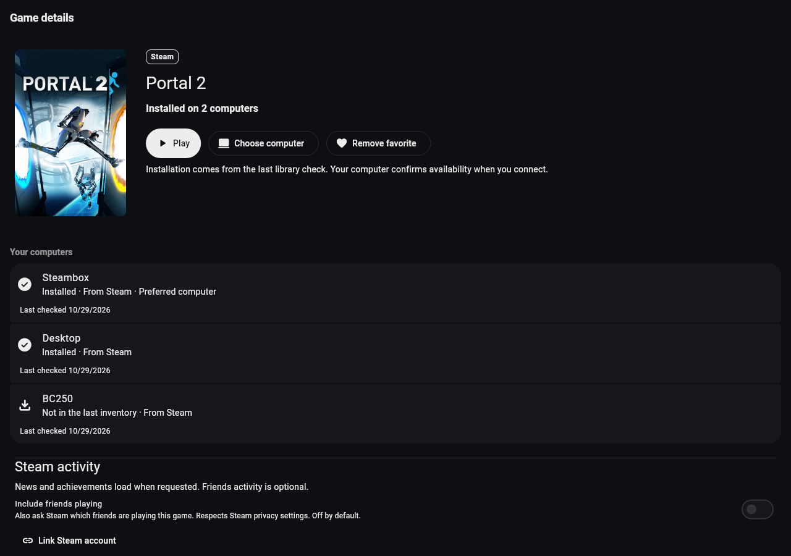
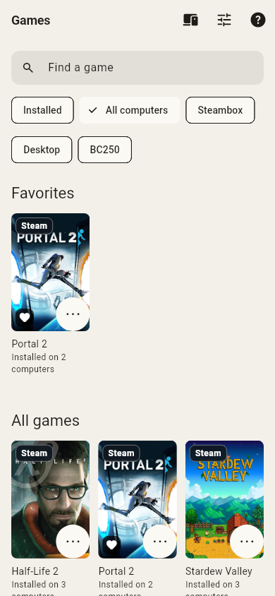
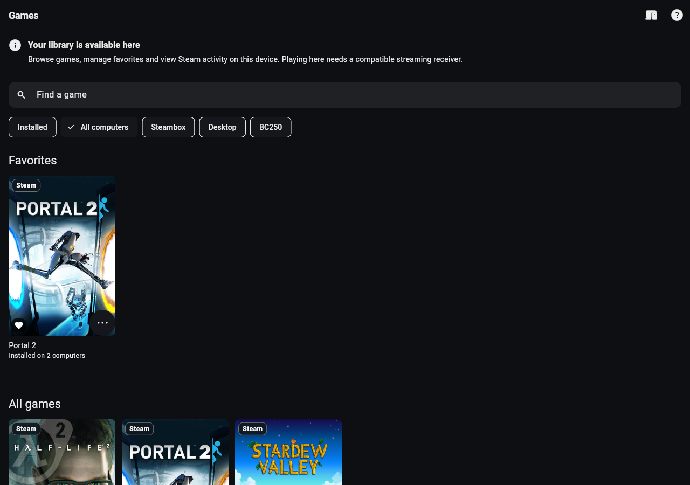

# Steam visual review

These are unedited captures of the production Flutter widgets using deterministic account/computer fixtures, real Roboto fonts and public Steam cover art. They are not screenshots of a live Steam session or physical platform qualification. Source commit: `db4376768ebf95b0c87afe7e0892fb723a346b74`. Dimensions and hashes: [receipt.json](receipt.json). Reproduction and remaining device checks: [VISUAL_EXPERIENCE.md](../VISUAL_EXPERIENCE.md).

| Capture | Review focus |
| --- | --- |
| [Desktop library](library-desktop-dark.png) | PlezyNG poster geometry, Steam attribution, multi-computer filters and observed installation counts |
| [Phone library](library-phone-paper.png) | Paper theme, wrapping filters, poster menus and captions |
| [Large RTL library](library-phone-rtl-large.png) | 2× text, directional layout and fewer columns; English fallback intentionally retained |
| [First use](setup-phone-light.png) | Independent computer pairing and Steam catalog linking paths |
| [Desktop details](detail-desktop-dark.png) | Artwork, primary actions, computer preference/installation rows and lazy activity |
| [Large RTL details](detail-phone-rtl-large.png) | Stacked responsive layout, prominent Play action and controller-only affordance |
| [Streaming settings](settings-tablet-dark.png) | Existing grouped settings and theme, distinct picture/sound and controller sections |
| [Stream recovery](stream-recovery-oled.png) | OLED, readable status, game/computer identity and reconnect in a small pane |

The detail test mounts the screen as its home route; the real pushed route also includes the existing back affordance. Below-fold content remains scrollable and its actions are exercised by the tests. No sign-in credentials, real account identifiers or private host inventory are present.

## Browse-only catalog follow-through

[Catalog on a device without an embedded receiver](catalog-only-tv.png) is a
ninth, separately captured production-widget view from code commit
`54298205c062ee2bf3c26fffbb9413df2584f1d7`. It retains existing poster/favorite
geometry, Steam attribution and multi-computer filters, explains local playback
availability, and omits streaming settings. Touch and D-pad activation open
details; menu tests retain favorites and omit playback/controller-only actions.
Its [separate receipt](catalog-only-receipt.json) preserves the original eight
captures' provenance. The actual GamesScreen loading/persistence/profile path
also passes separately under both webOS and Tizen build flags.

