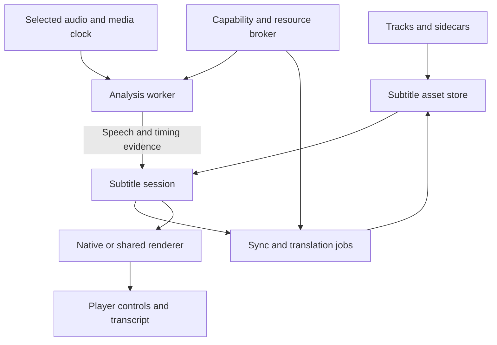

# PlezyNG subtitle implementation plan

Prepared for Keith on October 28, 2026, UTC. The initial source audit is pinned to `snapetech-org/PlezyNG` main at `7c27c543aacd988258d6964c4b2046707a5b737c`; PR #53 opened against `8e24382c96deca0cd13e762e021ab80b95173fe8`. The implementation and requirements are updated against the live PR branch, which has merged main through `e3450049cf477c74c535c27f3ecef3b7c8738607`. Source links preserve the initial audit context. Source presence is not device qualification; performance targets below are proposed acceptance gates, not measured results.

The catalogue contains **132 tracked requirements across ten work packages**, with existing-code mappings, competitor evidence, native-backend choices, and release gates. All requirements are in scope for this implementation effort; the work-package order records technical dependencies, not deferred approval phases. ASR means speech recognition; VAD means voice activity detection; SDH means subtitles for deaf and hard-of-hearing viewers; PTS means media presentation timestamps. RTF is processing time divided by audio duration, so lower is faster.

**Recommendation — confidence high:** extend PlezyNG's existing subtitle selection, rendering, download, and timing code. Add a shared subtitle session and document model, automatic synchronization, local transcription, translation, and optional companion processing. Preserve existing playback and UI ownership. Start with reliable timing and track identity, then CPU generation, opt-in desktop Vulkan/CUDA builds, local translation, and platform qualification.

**Feasibility — confidence high:** CPU subtitle generation and subtitle translation are practical; GPU/NPU acceleration is practical on supported device/runtime/model combinations. The integrated subtitle work includes local WAV-based ASR, Android ExoPlayer PCM capture, same- and cross-language subtitle sync/cut repair, word/token timings, device-local reviewed revisions, server upload, drop/share import, and cue replay paths. **Cross-platform player-owned PCM capture and per-operation accelerator placement remain unverified; device performance remains unknown until qualified on hardware.** **Demand ranking — confidence moderate:** the evidence shows recurring requests across projects, not a representative market survey. **Advanced audiovisual interpretation — confidence low:** usable prototypes are plausible, but accuracy cannot be promised.

## Current implementation status — October 29, 2026

**The plan is not complete or release-qualified.** The catalogue below remains
an acceptance specification. Source implementation, packaged artifacts and
measured behavior are separate states. No tests, builds, analyzers, dependency
installation, model execution, hardware qualification or CI were run for this
implementation pass, following the owner's instruction to do code work and push
with `[skip ci]`. Existing native dependency pins were not fabricated or promoted.

| Area | Implemented source paths | Remaining boundary |
| --- | --- | --- |
| Transcription and translation | Local whisper.cpp CPU/optional compiled desktop CUDA/Vulkan; Sherpa provider requests with fallback; ML Kit and desktop Argos; selected-range work; durable WAV/owned-source jobs and serialized whole-book generation; reviewed glossary/memory/model translation; cross-language sync and word timings. | Runtime/provider reports do not prove per-operation GPU/NPU execution. TV/accelerator packages and language quality need qualification. |
| Live/DVR | Ordered PCM consumption, seek generation retirement, immutable finalized cues, bounded retained history, ExoPlayer source-frame clocks and moving DVR origin rebasing; late/provisional text, overlapping stable-prefix agreement, backend-grid DVR delay and opt-in delay hold; completed-HLS-segment and explicit-timeline DASH audio analysis with desktop/TV playlists and mobile snapshots; bounded reconnect backoff, backward program-time anchoring within a continuity run and expiry against fresh DVR bounds. | Opt-in Sherpa Zipformer2 native streaming CPU recognition now retains state across PCM chunks with endpoint/provisional output. Its user-provided local model pack and runtime behavior need qualification; unrestricted future-audio ingestion remains unavailable. HLS requires explicit program timestamps; DASH requires clear audio/mp4, explicit segment timelines and UTC availability/publication clocks. Both need an active possibly estimated playback epoch and a capable local decoder. Native mobile snapshots accept bounded TS, relative fMP4 and packed AAC; OS codec/container support and clock/output behavior remain unqualified. Delay hold moves the viewer within backend bounds. |
| Playback/source access | Android Media3 pre-speed PCM processor; native MPV bridges; Tizen tap; Android MediaExtractor/MediaCodec and Apple AVAssetReader analysis bridges plus desktop FFmpeg read-ahead via renewable standalone/library source leases; explicit companion staging of eligible current VOD files on IO platforms. | Current locked MPV libraries lack the ordered ABI. webOS NDL has no direct PCM tap; there is no browser Player. Android/Apple native readers and source-built Tizen/webOS audio helpers are implemented. Native format support, TV subprocess policy, shipped helper artifacts and device behavior remain unqualified. Companion staging is limited to complete, accessible files up to 1 GiB/one hour; playlists/live/protected sources are refused. |
| Import and attachment | Existing format conversion/archive/drop/share flows; Plex/Jellyfin/Emby upload; managed standalone native text attachment; adapter-owned folder discovery for local/network/cloud sources; standard DLNA resources and namespaced SEC/PV caption links. | Backend format limits still apply. Non-MPV attachment refuses saved affine corrections. Unlisted catalogue sources, unsupported vendor formats and ambiguous renewed DLNA resource identities remain limited; protocol/device behavior is unqualified. |
| App rendering | Two independent text lanes, profile/lane appearance defaults, bundled/imported/script fallback fonts, original word highlights, authored signs, optional scene avoidance, manual cover, focused-pane limits, horizontal ruby, bounded vertical left/right columns, and spoken subtitles with explicit duck/rate. Centered contain/cover/stretch/zoom geometry and screen/video anchoring are implemented. | App layout does not implement full native ASS, OpenType vertical shaping or complete closed-caption services; SCC import now preserves 608 text-memory changes in an explicit flattened derivative. Ruby/highlighting remain horizontal. SCC import, mixed-language cue annotation, Watch Together caption relay, native HDR controls/status, offline font-store and app-overlay controls, live/DVR delay and UTC anchor dialogs, lyric syllable entry, local subtitle resource controls, and language-order settings use centralized strings with English fallback; broader translation review, HDR luminance, typography, rotation/output behavior and device qualification remain open. |
| Ecosystem | Corrected SRT/native snapshots and expiring LAN/WebVTT sharing on the opened-part clock; Cast loading/restoration; encrypted revision synchronization; explicitly paired, room-scoped Watch Together automatic publication and optional automatic display; profile/download/part-bound caption and font retention; text/font ZIPs, study tools, paused MPV caption-frame PNG/layered ZIP exports. | Watch Together offers either the same configured cloud folder or an expiring companion-hosted encrypted channel. Both require explicit code sharing, cut/audio confirmation and local conflict choices. Companion channels need reachable HTTPS hosting and do not extend the OWP relay protocol or authenticate a sender. Receiver/native PiP behavior remains capability limited. HDR/wide-gamut/unknown frames retain untouched native bytes plus a separate sRGB caption layer; flattened HDR/reference-white calibration and runtime qualification remain open. Selected Matroska/WebM TTF/OTF attachments can be retained through bounded local/owned-source reads; other container attachment formats remain unsupported. |
| Research | Image-reviewed OCR/text-band proposals, positioned signs, second-model disagreements, local speech separation, VAD coverage, sampled/locally tracked scene regions, explicitly configured joint audio/image review, original/harmonic lyric CTC word proposals, bounded stereo mix balance/delay/correlation evidence, licensed generic-voice dubbing/mixing and offline adaptation with separate holdouts. The app exposes bounded evidence/provenance review and digest/clock-bound JSON exports; selected wording survives image review. | All are opt-in experimental adapters without measured quality improvement. Physical sound localization, whole-title visual tracking and verified vocal-note timing remain unfinished. Anonymous local detector classes and conservative short-gap appearance matching now have a bounded research path; semantic/occlusion accuracy remains unestablished. Supplied syllable groups and bounded mix-pitch candidates now have explicit review paths. Provider modality use, singing/overlap quality and adaptation benefit are unestablished; no evaluation run occurred. |
| MPV packaging | Shared ordered-PCM patch and platform bridges; schema-3 final-archive receipts for all four exports, native/archive hashes, actual ELF/PE/Apple architectures and complete XCFramework slices; receipt-aware content keys, manifest freshness and atomic consumer promotion. | No new binaries were built/published and no consumer lock was advanced. Private-JIT build/publication and exact-artifact promotion in MPV-PACKAGING.md remain required. Export/architecture evidence does not establish runtime timing or device qualification. |

The appended source updates identify implementation details and bounds. They do
not supersede the unfinished boundaries above or the definition of done. Derived
files keep originals intact; optional processing and sharing remain explicit.

The latest connected source paths are documented separately:

- [Portable caption defaults](PORTABLE-DEFAULTS.md): bounded per-profile appearance/role file and encrypted cloud transfer, full field preview and explicit local/shared conflict choices.
- [Resumable source jobs](SOURCE-JOBS.md): bounded decoder windows, durable text checkpoints, explicit source/audio rebinding and part-clock review.
- [Native HDR controls](NATIVE-HDR.md): active gpu-next/option probing, independent text/OSD and bitmap diffuse white, readback and explicit restoration; no app/display calibration.
- [Direct and standalone live media](STANDALONE-LIVE.md): explicit transient source-analysis grants, Media3 window clocks/bounds and expiring paused-frame UTC fallback anchors; no inferred DVR bounds.
- [Mixed-language spans](LANGUAGE-SPANS.md): explicit annotations, horizontal glyph/accessibility locale, retained word timings for annotation-only edits, JSON/WebVTT preservation and SRT flattening.
- [Book-wide transcripts](BOOK-TRANSCRIPTS.md): explicitly selected per-file revisions, bounded aggregate search, guarded source seeks and provenance-bound JSON; ordinary source books require complete file durations.
- [Supplied-result evaluation](RESULT-EVALUATION.md): paired lexical/timing errors, supplied streaming latency/stability, confidence review and resource traces with explicit missing coverage; no recognizer execution or qualification result.

The source changes above are committed with `[skip ci]`. Confidence is high in
verified Git publication, moderate in unexecuted source integration and unknown
in device/runtime quality. The release and research boundaries in this document
remain acceptance work, not success claims inferred from code presence.

# 1 What PlezyNG already has

The correct starting point is an established subtitle system. Rebuilding track selection or replacing libass would create avoidable regressions. The table distinguishes working code paths from settings, engine capabilities, and proposed additions.

| Existing area | Verified source and behavior | Extend or repair |
| --- | --- | --- |
| Shared player abstraction | `Player`, `PlayerBase`, `PlayerNative`, and platform implementations expose tracks, selection, properties, and events. [C01] | Introduce explicit subtitle capabilities and an analysis interface without another player owner. |
| Primary and secondary subtitles | `TrackSheet` selects primary and secondary tracks, provides numbered badges, and clears secondary when appropriate. `PlayerNative.selectSecondarySubtitleTrack` writes `secondary-sid`. [C02] [C03] | Make secondary selection discoverable, add independent timing/style, and qualify every renderer. This is an extension, not a new mpv feature. |
| Backend differences | ExoPlayer, Tizen, and webOS return `supportsSecondarySubtitles == false`; mpv inherits true and implements selection. [C04] | Add per-operation support results; do not promise all-platform dual subtitles from the existing Boolean. |
| Manual timing | `SyncOffsetControl` offers a ±10-second slider, 50 ms subtitle steps, 1-second held steps, and ±60-second absolute limits. Audio uses 10 ms steps. [C05] | PR #53 adds exact signed millisecond entry, MPV cue-step alignment, independent secondary delay, and bounded two-anchor linear-drift calibration for the active MPV text subtitle. The calibration applies a scoped timestamp multiplier and delay; image subtitles and unsupported players do not expose it. The drift dialog previews without saving and restores the prior delay/rate on cancel; one-step Undo restores the prior saved rate/delay until another timing edit or item change. Standalone MPV OpenSubtitles assets also persist calibrated delay/rate by profile, source edition, file fingerprint, subtitle digest, and selected audio descriptor; changing audio reapplies only its matching correction or neutral timing for an uncalibrated stream. One-cue alignment and corrected SRT/VTT plus safe ASS/SSA export are implemented for standalone MPV VOD. PR #53 adds local-WAV same-language ASR alignment and piecewise offset repair around text-match discontinuities. It reports matched cues and an estimated discontinuity count; it does not extract audio from playback, inspect container edit lists, or identify release cuts with a source fingerprint. |
| Timing persistence | `PlayerSyncOffsets` tracks what is actually applied; `ScopedPlayerPrefs` supports off/global/library/title scopes and resets on item changes. [C06] | Add edition/audio/subtitle-qualified correction records. The new subtitle timestamp multiplier uses the existing off/global/library/title scope; a title-level offset or rate is still insufficient for different cuts or downloaded subtitle releases. |
| Semantic preferences | `SubtitlePreference` separates item-local identity from cross-item `SubtitleIntent`; language and effective forced status are hard matching requirements. [C07] | A selected subtitle now carries explicit SDH/CC title-marker parity across library episode changes and saved show preferences, declining mismatched tracks so the server fallback remains available. This is title-based because the shared server/native contracts lack a dedicated hearing-impaired field. Ordered languages, regional script, origin, and generated-track intent remain open. Never carry raw native IDs across episodes. |
| Server and native reconciliation | `TrackManager`, `TrackSelectionService`, and `PlaybackSubtitleResolver` reconcile native tracks, source rows, sidecars, transcodes, and burned subtitles. [C07] [C08] | Keep these authorities. Add derived assets and explicit source/audio identities rather than bypassing them. |
| Selection races | Track management waits for late subtitle discovery, retires automatic selection after user action, and tracks session transitions. [C08] Subtitle AI operations snapshot player media-session, active profile, and revision identity before work; attachment and history restore reject a changed player/profile/source, even if no stable revision key was available. PCM capture also snapshots item, audio-track, and timeline-seek generations and discards a capture after a seek. Server subtitle download/apply polling now pins the selected media version and known source part across refreshes, so a result is retired if playback switches versions mid-download. | Extend equivalent generation guards to future OCR jobs and any download path that does not yet carry source identity. |
| Server search | `SubtitleSearchSheet` calls backend search/download. Jellyfin/Emby adapters normalize language, hash-match, forced, hearing-impaired, and provider metadata; provider setup and server permissions still govern availability. [C09] | Unify result ranking and error states without making every server behave like Plex. |
| Automatic preferred-language download | `_fetchPreferredSubtitleIfNeeded` already searches when enabled, ranks perfect matches ahead of other results, downloads, rediscovers the source stream, and builds a sidecar. It skips offline/live, explicit preferences/off, and existing server selections. [C10] | Reuse it; improve confidence, provenance, nonblocking startup, and fallback to generation. Do not list automatic download as wholly missing. |
| Standalone source search | `OpenSubtitlesClient` and `StandaloneSubtitleSearchSheet` support API-key-backed direct search/download, including title IDs and SDH/forced result metadata. [C11] | PR #53 previews bounded SRT/VTT/ASS/SSA cue times and lines before applying a direct OpenSubtitles candidate. It persists applied OpenSubtitles text assets for MPV VOD in app-managed storage, bound to profile, source item, selected edition, and current file fingerprint; it records language/forced/SDH metadata, verifies SHA-256 on restore, and caps each file at 8 assets / 20 MiB. Delay/rate corrections are saved per selected audio descriptor and reapplied after audio-track changes. For exact local or cached files with a known matching byte size, search also sends the OpenSubtitles moviehash and ranks provider hash matches first. Release fingerprint matching and network-only source hashing remain open. |
| Source subtitle lifetime | `SourcePlayback.applyExternalSubtitle` attaches a bounded external track to MPV. [C12] | PR #53 keeps matching MPV VOD assets in an atomic, profile-scoped source-edition/file cache with manifest recovery and content verification. Delay/rate corrections are stored by subtitle digest and selected audio identity. This branch adds bounded SRT/VTT/ASS/SSA uploads to Plex, Jellyfin, and Emby library items; MediaBrowser uploads carry language/forced/SDH metadata and Plex receives the supported filename/format fields. The server's upload permissions decide whether a write is accepted. Generated, translated, and repaired derivatives can be attached to the active session; persistent MPV source items can also save those SRTs into the existing profile/edition/file-scoped sidecar cache. Provider-side source writes, custom subtitle roots, and cross-device sync remain open. The upload path is not test-verified or device-qualified. |
| Local subtitle import | The track sheet previously hid ExoPlayer despite an existing native `addSubtitleTrack` path; its shared `command` adapter did not route `sub-add`. Tizen/webOS command handlers were no-ops. [C02] | PR #53 adds a format capability contract and routes local SRT/ASS/SSA/VTT to ExoPlayer VOD, bounded SRT/VTT overlays to Tizen/webOS, and keeps mpv’s existing formats. ZIP preflight checks central-directory bounds and caps inputs at 50 MiB compressed / 64 MiB expanded / 32 MiB per member. Plain TAR preflight verifies header checksums and end markers, rejects links, special files, PAX/GNU extensions and unsafe paths, and applies 50 MiB input / 64 MiB expanded / 32 MiB per-member limits. Both formats materialize only backend-supported entries; paired IDX/SUB archive and share/drop imports require both files. Direct MPV IDX picking now validates a matching SUB beside the selected file and enforces size bounds; path access still needs device qualification. Bounded Android share-intent files and desktop drop files/ZIPs/TARs enter the same import candidate flow. Live ExoPlayer attachment remains open. Android and TV device behavior is not qualified. |
| In-player appearance | `InPlayerSubtitleStyleSheet` exposes font size and vertical position. [C13] | This PR now exposes text color, bold/italic, outline size/color, and background opacity/color in-player for MPV and ExoPlayer, while unsupported TV backends hide the style action. Independent primary/secondary targeting and presets remain. The sheet now includes a one-tap reset to stored defaults. |
| Full appearance settings | `SubtitleStylingScreen` already provides ASS override choices, render-resolution choices, font size/color, position, margins/anchoring, bold/italic, outline, and background with preview. [C14] | Reuse existing settings and preview. Add legibility controls and apply/error acknowledgement. |
| ASS and bitmap rendering | mpv/libass and Android's libass atlas/rendering code provide substantial native rendering infrastructure. Android also has PGS parsing and subtitle geometry tests. [C15] | Preserve ASS drawing, overlap, fonts, positioning, and karaoke. Derived plain-text views must not silently destroy the original track. |
| Android subtitle delay | ExoPlayer forwards `sub-delay` into `setSubtitleDelay`; native text and ASS rendering account for that offset. `AssLatencyCalibrator` concerns overlay/video presentation latency. [C15] | Keep presentation calibration separate from dialogue-to-cue alignment. The calibrator is not automatic subtitle synchronization. |
| Tizen and webOS | Tizen implements SRT/VTT sidecars with bounded reads and a timed caption path; webOS selects native indexed subtitle tracks and forwards subtitle sync. Both lack secondary selection. [C04] | Qualify bitmap/styled/native tracks separately; implement shared generated-text overlays only where surfaces, clocks, PiP, and exports permit. |
| Downloads | Supplementary subtitle downloads are already resolved and stored per media part, with retry and cleanup integration. [C16] | Include original/translated/generated assets, fonts, revision manifests, and incomplete-job recovery. |
| Visibility and burned text | Existing controls distinguish hiding an overlay from changing a subtitle burned into a server rendition. [C17] | Keep this distinction in all new actions. Hide cannot remove pixels from an already encoded video. |
| GPU and native foundations | Native video output, hardware decoding, libass compositing, and DV work are present. The reviewed source does not establish a general speech-inference runtime, model registry, PCM analysis API, or production NPU subsystem. [C01] [C15] [C18] | PR #53 adds whisper.cpp package integration for multilingual CPU and optional compiled desktop CUDA/Vulkan, plus Sherpa ONNX Moonshine provider requests for Core ML/QNN/RKNN. The API can report the selected/requested backend and CPU fallback, not per-operation placement. Video decode acceleration still does not imply ASR acceleration; device builds and NPU support need qualification. |

Two baseline corrections matter. First, the `Player` factory and `SettingsService.useExoPlayer` select **mpv by default on Android**, with ExoPlayer opt-in; a README footnote still says otherwise. Second, source-path subtitle search and media-server playback are separate flows today. The new subsystem must serve both, without assuming a `MediaItem` exists for every source. [C01] [C12] [C19]

Open PR #40 at `5e1985066d1aecaeb6a4fa240f5203a846d8cae5` adds motion controls and an FFmpeg `minterpolate` adapter. It is not a shipping general neural/NPU inference layer. Open PR #43 at `cabeb731919b11da1a76bf6119feb4e9af96295d` changes shared player/source controls, bookmarks, and looping. Reconcile both before editing overlapping files; neither is part of this main snapshot. [C20] [C21]

## Platform baseline

| Playback path | Existing subtitle path | First AI implementation | Main qualification gap |
| --- | --- | --- | --- |
| Linux and Windows mpv | Native track selection, secondary track, libass, property-based timing/style | Native CPU worker plus Vulkan; optional HIP/CUDA builds | PCM access, display-plane integration, resource contention, sandbox packaging |
| macOS and iOS/tvOS mpv integration | MPVKit/libmpv with Apple-specific video output; subtitle plumbing remains native | CPU/Metal first; Core ML/ANE adapter independently benchmarked | PiP, AVFoundation composition, memory/thermal/background limits; no assumption that mpv GPU filters are available |
| Android mpv | Primary/secondary mpv path | CPU; Vulkan where qualified; optional vendor NPU later | Decoder/passthrough coexistence, process lifetime, device/driver variability |
| Android ExoPlayer | Native text plus custom ASS rendering; primary only; PR #53 routes local SRT/ASS/SSA/VTT import through the existing Media3 re-prepare path, preserving the current position on VOD | Analysis decoder or approved PCM tap; generated-text renderer | Live external attachment, dual renderers, clock mapping, hardware offload; no Android device qualification in this PR |
| Tizen | Native video, remote sidecars, and local SRT/VTT overlay import (PR #53; not device-qualified) | Companion-generated or precomputed captions first | Hardware/firmware timing, PiP, and limited CPU/storage/API access |
| webOS | Native indexed track selection/sync plus local SRT/VTT text overlay import (PR #53; not device-qualified) | Companion/precomputed output for generation | Overlay timing/placement, PiP, and supported devices/firmware |
| Cast/external player | Receiver owns rendering and often fetches media independently | Export/serve compatible sidecar or explicit burn-in/transcode | Local Flutter overlays do not travel to the receiver |

# 2 What competitors do well and where the opportunity remains

These are documented capabilities and bounded gaps, not claims that every version or device behaves identically.

| Client or tool | What to borrow | Limitation or lesson for PlezyNG |
| --- | --- | --- |
| Plex | Automatic speech-activity-based synchronization; familiar language defaults and subtitle search. | Documented auto-sync requires analysis and Plex Pass entitlements, handles external SRT, analyzes the primary audio track, and has limitations around large offsets and inconsistent cuts. PlezyNG can support the actual selected audio and non-Plex sources. [W01] |
| Infuse | Low-friction subtitle downloads and broad format coverage in an integrated media-library player. | Repeated dual-subtitle and automatic-sync requests identify opportunities. Request threads establish demand; they do not prove every current Infuse build lacks every proposed feature. [W02] [W03] [W04] |
| mpv | Dual tracks, timing offsets, timestamp scaling, cue navigation, ASS support, and scriptable commands. | Secondary rendering has styling and bitmap-position caveats. Engine capability needs a discoverable UI and reliable persistence. PlezyNG already uses this foundation. [W05] |
| IINA | A native interface around mpv, provider plugins, online subtitle search, and clickable-subtitle extensions. | Plugin features are not the same as built-in cross-platform behavior. Borrow provider interfaces and word lookup without depending on user-installed scripts. [W06] |
| Kodi | Forced/language/hearing-impaired preferences, custom subtitle directories, extensive style controls, HDR UI-luminance control. | Text styling cannot restyle bitmap glyphs. Preference breadth needs understandable controls. Keep Keith's separate subtitle directory possible. [W07] |
| VLC | Delay shortcuts and a bookmark-audio/bookmark-subtitle/apply workflow that is more usable than guessing offsets. | A demonstrated or early-access AI feature is not a universally delivered desktop/mobile feature. Videolabs' current AI plugin page explicitly says it is not generally available. [W08] [W09] |
| Jellyfin clients | Server metadata and provider integration; web and native clients serve different use cases. | Dual-subtitle demand persists in Desktop; historical Android TV offset requests show the cost of uneven client support. Avoid treating the entire ecosystem as one feature set. [W10] [W11] |
| Emby | Server-driven manual and automatic subtitle downloads with provider plugins and matching controls. | Downloads depend on server configuration and permissions; discovery does not itself solve timing, wrong editions, or generation. [W12] |
| MPC-HC | Efficient native rendering, optional libass, WebVTT, manual/automatic subtitle search, and configurable player controls. | Its Windows desktop model is not a portable mobile/TV implementation. Useful quality and power-user reference. [W13] |
| Subtitle Edit | Rich editing, waveform timing, OCR, translation, speech recognition, format conversion, and batch work. | It is an authoring workflow. PlezyNG's opportunity is to make selected capabilities work safely during playback, then offer advanced editing on demand. [W14] |
| Bazarr | Automated provider search, audio synchronization, Whisper fallback, and translation integrations. | Useful companion integration for libraries. It does not eliminate the need for player-clock-aware live generation, transient streams, or per-viewer preferences. [W15] |
| Language-learning extensions | Dual text, word lookup, cue replay, saved vocabulary, and automatic pause at cue boundaries. | These interaction patterns can be integrated with local files, offline viewing, and remote controls. [W16] |
| Windows/Chrome live captions | Captions for otherwise uncaptioned audio; supported translation modes. | OS/browser captions are not automatically edition-bound, exportable subtitle assets controlled by the media client. Supported language/output combinations differ. [W17] [W18] |

## Recurring demand ranked for implementation

| Priority | Demand evidence | PlezyNG response |
| --- | --- | --- |
| 1 | Infuse automatic-sync requests span years; Plex shipped a constrained implementation. | One-action sync with preview, confidence, undo, selected-audio analysis, and drift/cut support. |
| 2 | Infuse multiple-subtitle threads recur over years. Jellyfin Desktop #1223 revisits an earlier issue described as having 47 thumbs-up; the current issue remains open at retrieval. | Finish dual-track UX and timing on mpv; extend capable non-mpv paths instead of claiming universal support. |
| 3 | Jellyfin Android TV #1234 accumulated 32 thumbs-up and 4 hearts; it is closed, so use it as historical demand, not proof of a current missing feature. | Explicit per-backend capability matrix and the same understandable timing controls wherever implemented. |
| 4 | Upstream Plezy #689 requests styling without leaving playback and has 7 thumbs-up. PlezyNG already implements size/position. | Complete the existing in-player style sheet; do not rebuild it. [C22] |
| 5 | Subtitle Edit, Bazarr, and emerging VLC integrations show active delivery around ASR, OCR, and translation. | Integrate these in a playback-oriented workflow. Demand for an exact PlezyNG implementation is unquantified. |
| 6 | Styling/position/overlap reports demonstrate edge cases that survive nominal format support. | Treat ASS fidelity, bitmap geometry, accessibility, HDR brightness, and overlap as first-class acceptance work. [W19] |

The most defensible differentiation is **reliable subtitle behavior across sources and devices**, with automatic repair and local generation behind the existing subtitle controls. The largest recurring gaps are integration, identity, timing, and delivery consistency; an additional model alone does not solve them.

# 3 User experience and selection policy

Keep the existing Tracks/Subtitles sheet. Its main rows are Off, Primary, and optional Secondary. Below them, group **Find or add**, **Timing**, **Appearance**, and **Translate or generate**. Advanced controls expand inside those surfaces. Put transcript/search/learning tools behind a secondary action. Do not add a top-level subtitle section to the main navigation.

During playback, **Fix timing** offers automatic analysis, a short before/after preview, Apply, and Undo. **Translate** offers the source track and target language, then attaches a separate derivative. **Generate** offers audio language, quality, and whether to process this device or a configured companion. Runtime/model details belong in advanced status; the ordinary flow should say Ready, Preparing, Generating, or Unable to keep up, with a concrete next action.

Proposed selection order: explicit current-session choice or Off; valid saved choice for this edition; configured semantic preference; authoritative server selection; optional preferred-language provider search; optional translation of a suitable existing track; optional ASR generation. Respect the existing server/default ladder during migration: implement this as a reconciled policy with regression fixtures, not a wholesale reorder. Explicit Off suppresses automatic fallback. Missing subtitles must not unexpectedly start model downloads or cloud processing.

Separate preference axes: spoken-audio language, preferred subtitle languages, regional script, forced versus full dialogue, SDH/CC preference, primary versus secondary, and origin preference. A subtitle language can differ from the audio. A translation of original dialogue can differ substantially from a localized dub; offer **Match selected audio** when that matters.

# 4 Shared architecture

Use a shared `SubtitleSession` for both `VideoPlayerScreen` and `SourcePlayback`. It coordinates existing owners rather than replacing the player. Heavy work lives in native workers or an optional companion. Flutter owns controls, progress, selection, and document editing.

## Domain contracts

| Proposed contract | Required content and invariants |
| --- | --- |
| `SubtitleAssetKey` | Profile, source identity, media representation/edition, part, subtitle content digest, selected analysis-audio identity where relevant. Signed URLs and native track ordinals are not durable identity. |
| `SubtitleDocument` | Original bytes/reference; parsed cue graph; language/script; format; track roles; metadata; attachments; immutable revision; generated/translated/OCR provenance. Keep authored material intact. |
| `SubtitleCue` | Stable ID, source start/end in integer microseconds, text spans or bitmap references, region/layer, optional word spans, speaker label, confidence/uncertainty, and source-cue correspondence. Overlapping cues are valid. |
| `TimelineTransform` | Offset, affine mapping, piecewise mapping, unmapped ranges, user anchors, confidence evidence, and transform revision. Editing text and editing timing are independent operations. |
| `SubtitleSession` | Current source/audio/edition/part, primary/secondary asset and revision, playback epoch, selected policy, applied transforms, in-flight jobs, renderer acknowledgement. |
| `SubtitleCapabilities` | Select/import/dual/style/delay/affine/cue-stream/bitmap/ASS/PCM/read-ahead/PiP/cast/export capabilities, per format and renderer, with supported/unsupported/unknown plus reason. |
| `MediaAnalysisSource` | Selected audio access, decoder configuration, PTS and discontinuities, seek/range access, authenticated renewable transport, and a permitted extraction mode. Never assume a public file URL. |
| `AsrBackend` | Model/language/task support, actual execution device, precision, startup and streaming modes, cancellation, bounded audio submission, partial/final outputs, measured resource use. |
| `TranslationBackend` | Explicit language pairs, context limits, glossary support, origin, model revision, structured cue correspondence, cancellation, and optional remote execution. |
| `AnalysisJobStore` | Durable state, input digests, checkpoint ranges, dependencies, priority, retry/backoff, cancellation, revision guards, and atomic result commit. |
| `InferenceResourceBroker` | Real device capabilities and measured budgets shared with video decode, shaders, DV, motion interpolation, multiview, games, and other inference. |

Every asynchronous output includes `profileId`, `sourceRevision`, `audioTrackKey`, `playbackEpoch`, `jobId`, and sequence/revision. A seek retires obsolete live work; an audio switch starts a distinct transcript; changing profiles cancels and isolates jobs. Stale results may remain as valid cached assets for their original input, but may never select or display themselves in the current session.

## Audio extraction and playback clocks

Prefer a native pre-output audio tap with original media timestamps. Use a dedicated bounded analysis decoder for VOD read-ahead and when passthrough/offload does not expose PCM. Preserve the audible output mode; do not silently decode an Atmos/DTS bitstream into a different playback output merely to obtain speech samples. A second analysis stream may consume bandwidth or fail on a one-shot/live/protected source; capability detection must state that.

Keep original channel layout for optional speaker/separation analysis. Produce the ASR model's required input separately, commonly 16 kHz mono for Whisper, with known resampler delay. Never feed time-stretched playback audio as if it were source-time audio. Center-channel weighting is optional and falls back to the full mix; dialogue is not guaranteed to occupy the center channel.

Use integer source PTS and explicit mappings for source start offsets, multipart media, transcode seek bases, HLS discontinuities, DVR windows, and playback speed. UI timers and wall-clock timestamps are not the authority. Keep manual audio delay, subtitle correction, and measured output-plane latency as separate terms and apply each exactly once. Test sign conventions with a tone/word/cue fixture.

Native rings should be bounded and nonblocking. A 60-second 16 kHz float32 mono ring is 3.84 MB before metadata; original multichannel buffers are larger. Pass buffers through FFI/shared native ownership, not repeated large platform-channel JSON messages. Throttle events and handle cancellation outside the audio callback.

## Rendering and storage

Render original authored ASS with the existing native path. For secondary subtitles, preserve documented mpv limitations until a tested renderer enhancement exists. Build an independent text/cue representation for search, translation, learning, and editing; it is not a replacement for the original ASS script. Use a dedicated generated-text track or bounded native cue stream for live output. Do not repeatedly reload an ever-growing SRT and hope track selection, timing, and memory remain correct.

Persist derived assets under a profile-scoped managed store, with an optional configurable external subtitle root. Support Keith's `/mnt/datapool/subs` arrangement without moving existing files beside videos. Keep media fingerprints and a manifest that maps files to subtitle assets. Export beside media only when that destination is explicitly chosen. Downloads and source transports retain their current authority over files and credentials.

Cache keys include audio identity, source representation, model checksum, task/language, precision where output differs, decoder settings, glossary revision, and transformation version. Reuse a source transcript across translations; do not retranscribe each target language. A changed dub or cut must invalidate the corresponding timeline/ASR binding. Reuse across server URLs only after content identity is established.

# 5 Synchronization from simple correction to difficult edits

**Confidence high:** ordinary synchronization should start with lightweight analysis. Speech recognition is an optional escalation, not a prerequisite. `ffsubsync` aligns speech/subtitle activity, while `alass` provides a useful reference for split-aware alignment. WhisperX demonstrates word alignment, but overlapping speech and unsupported alignment vocabularies remain limitations. [W20] [W21] [W22]

| Timing problem | Proposed method | Refusal or escalation condition |
| --- | --- | --- |
| Constant delay | Manual offset; one anchor; VAD/subtitle-activity correlation | Sparse dialogue, repeated patterns, weak correlation, wrong audio |
| Uniform drift | Two anchors or robust affine fit across several windows | Residuals vary by scene; a single stretch damages good sections |
| Frame-rate conversion | Explicit timestamp ratio with anchor preview | VFR alone does not imply a subtitle-speed correction; never infer only from nominal FPS |
| Added logos or trimmed opening | Offset after finding matching dialogue | Nonmatching early content must remain unmapped |
| Ads, recap removal, different cuts | Piecewise monotonic alignment with insertion/deletion handling | Missing scenes cannot be repaired by stretching unrelated lines |
| Accurate words but bad cue boundaries | Forced alignment on the same spoken language and matching transcript | Translation, paraphrase, dub differences, music, or overlapping speakers invalidate literal alignment |
| Translation with different segmentation | Match broader speech activity or an already aligned source subtitle | Do not force-align translated words to unrelated phonemes |
| Live/DVR timestamp jumps | Segment-aware PTS mapping and epoch resets | A discontinuity is not a gradual drift to smooth over |
| Audio device/render latency | Existing audio delay and presentation calibration | Never bake a Bluetooth/output-specific delay into a portable subtitle asset |

Canonical timestamp mapping is `t_media = a × t_subtitle + b`. One anchor determines `b` with `a = 1`; two distinct anchors determine `a` and `b`. For example, if subtitle time 60 seconds belongs at media time 62 seconds and subtitle time 660 belongs at 662.6, then `a = 1.001` and `b = 1.94`. Transform both cue boundaries. Positive `b` delays display. Test actual mpv option composition before mapping this directly to `sub-speed` and `sub-delay`; exporting transformed timestamps is the portable reference implementation.

Automatic procedure: validate track and audio identities; obtain bounded speech activity windows; remove obvious nonspeech subtitle events from the alignment signal without deleting them from the asset; fit global offset; inspect residuals across independent windows; try affine mapping; escalate to piecewise matching; optionally use ASR/forced alignment for ambiguous same-language sections. Evaluate a held-out window before proposing a correction. Do not treat a correlation coefficient as a calibrated probability.

Use robust estimation, monotonic constraints, minimum anchor spacing, rate-change limits, and explicit unmapped spans. Permit discontinuous jumps for edited cuts, but prevent time reversal. Avoid forcing continuity across content that was removed. Keep a correction undo stack, user anchors, and a reset-to-original action. A low-confidence result must leave playback unchanged and offer manual anchoring or another subtitle release.

For ASS, shifting event boundaries is straightforward; changing event duration can also affect karaoke syllables, animated transforms, fades, and movement timing. An affine or piecewise repair must transform relevant internal timing consistently, or mark that track as unsupported for full-fidelity retiming. For bitmap tracks, shift presentation events; font and wording changes require OCR or another source. Never convert a complex ASS script to SRT as a silent repair.

# 6 Subtitle generation during and before playback

**Yes: generate on the CPU, GPU, or a supported NPU.** The useful distinction is whether analysis has access to future audio.

| Mode | Behavior | Product contract |
| --- | --- | --- |
| Prepare entire title | Background ASR, alignment, segmentation, optional translation and review | Most stable output; resumable; exported and reusable |
| VOD read-ahead | Decode ahead of the playhead and maintain a caption buffer | Can display captions on time after a startup buffer if sustained throughput is sufficient |
| True live | Consume only audio that has arrived | Captions necessarily trail speech; show provisional text only in the selected low-latency mode |
| Delayed live | Hold video/audio playback behind the live edge by a user-selected amount | Trades live latency for stable, synchronized captions |
| Companion processing | Stream bounded audio windows or grant narrow source access to a configured machine | Enables TV/low-power clients; includes network and queue latency |
| On-demand repair | Regenerate a selected interval or fill a verified gap | Preserve existing human/edited lines outside that range |

Whisper is a strong baseline, but its translation task is into English; it is not arbitrary language-to-language subtitle translation. `turbo` is not trained for translation. Use a separate translation stage for arbitrary targets. Streaming wrappers need overlap handling, context management, and stable-prefix commitment; WhisperStreaming is a useful design reference but its maintainers point to SimulStreaming as the successor. [W23] [W24]

PR #53 integrates whisper.cpp through flutter_whisper_ggml for multilingual CPU transcription and optional desktop CUDA/Vulkan devices when the packaged native runtime includes them. CPU is the package default; explicit opt-in native build commands are in [BUILD-ACCELERATORS.md](BUILD-ACCELERATORS.md). It also integrates sherpa-onnx with an English Moonshine model for Core ML/QNN/RKNN provider requests and CPU retry. This is file-based processing only; a versioned native PCM streaming API, resource broker, measured execution placement, VOD read-ahead, and companion jobs remain follow-up engineering. Do not make a Python environment a mandatory mobile-client dependency. [W25] [W26] [W27]

Generation stages: decode/resample; VAD; language detection with a user override; ASR; timestamp reconciliation; punctuation/casing; cue segmentation; optional word alignment; optional diarization; validation; renderer publication. Keep verbatim recognition separate from optional cleanup. A text model must not invent missing dialogue to improve fluency.

Use overlapping audio windows and stable token/cue IDs. Distinguish partial, stable, and finalized results. Commit stable prefixes rather than replacing the whole screen on every decode. Finalized cues cannot change while being read without an explicit correction policy. Cancel obsolete windows on seek, prioritize the new playhead, and reuse valid cached ranges. On EOS, flush the trailing speech segment. On pause, allow bounded read-ahead or background completion according to policy.

Control common failures: silence/music hallucination, repeated phrases, phantom credit lines, wrong language after a long silent intro, timestamp drift, duplicate overlap text, clipped last words, code-switching, profanity/name corruption, and speech drowned by effects. VAD plus language/task constraints and repetition checks reduce errors, but VAD is not proof of correctness. Low-confidence speech should be marked or left uncertain, not silently replaced with plausible dialogue.

**ASR is not complete SDH.** Speaker names, sound descriptions, music identity, tone, and offscreen events require separate evidence. Anonymous diarization labels may be useful; do not infer a character's name solely from voice clustering. Existing authored SDH remains preferable when it is correct. Optional sound-event captions and visual speaker association belong in later, separately evaluated stages.

## Proposed performance targets

Targets have **moderate confidence as engineering goals** and **unknown confidence on unmeasured devices**. Measure warm and cold operation, not just a model's isolated throughput.

| Metric | Initial acceptance target |
| --- | --- |
| VOD throughput | Sustained real-time factor no worse than 0.5 on a qualified 1× playback tier, leaving room for decoding and translation |
| Faster playback | Require `RTF × playbackSpeed < 1`; target 0.5 or less for headroom, so 2× playback targets RTF ≤0.25 |
| Caption buffer | Start with configurable 20–60 seconds read-ahead; bounded growth; never unbounded whole-file PCM storage |
| Live draft | Aim for first useful partial text within 1.5–3 seconds of speech onset on a qualified streaming model/device |
| Live finalization | Aim for p95 finalization within 5 seconds after utterance end for the declared language/content profile |
| Synchronization repair | For accepted global-offset fixtures, recover injected offset within 100 ms; for realistic accepted dialogue anchors, target p95 error ≤250 ms and publish coverage/refusal rate |
| Playback interference | No analysis-induced audio underruns in qualification runs; compare dropped frames against analysis-off baseline |
| Backpressure | Never grow queues indefinitely; reduce work, switch to prepared mode, or report that the chosen quality cannot keep up |
| Quality | Publish WER/CER, name/number errors, timing error, omissions, hallucinations, and language-specific results; no universal accuracy percentage |

FFmpeg now documents a Whisper audio filter with GPU, queue, VAD, and structured-output options. It is a useful prototype/batch adapter, but its existence does not mean PlezyNG's pinned builds enable it. Do not put a blocking ASR filter in the audible playback chain. Prefer a separate worker and structured output; inspect the actual packaged build. [W28]

# 7 Localization and translation

Treat these as separate tasks: translate subtitle content, adapt writing for a region, render its script correctly, and localize PlezyNG's controls. Slang UI translation is already part of the application; it does not translate the video.

Translate a trustworthy existing subtitle before generating a new transcript. Preserve source cue IDs, speakers, emphasis, forced/sign roles, names, numbers, and uncertainty. Join adjacent fragments into sentences for translation, then resegment using source timing and target-language reading limits. Do not demand one translated sentence per original cue when the language order makes that unnatural. Every derivative retains many-to-many source correspondence.

Provide faithful/natural/literal-learning presets with conservative defaults. Optional regional vocabulary, spelling, formality, honorific handling, name transliteration, units, and glossaries should be explicit choices. Never silently change quantities, currency, plot details, speaker identity, or the censorship level. Keep a series glossary and translation memory keyed by language pair and revision; distinguish a user's correction from a model suggestion.

Protect ASS tags, drawing commands, timestamps, placeholders, and markup from translation. Parse them structurally; do not rely on a regex that assumes every brace means plain text. Reject output with missing cue IDs, malformed structure, altered protected tokens, missing dialogue, or implausible expansion. Treat subtitle/model text as data, never executable tool instructions. A translation failure leaves the source track available.

For local engines, evaluate packaged translation pairs such as Argos-compatible models and suitable multilingual text models. Choose a model only after per-pair quality and redistribution review; architecture and model-weight permissions are distinct. NLLB-200 is a useful research comparator, but its model card uses CC-BY-NC and describes research rather than production deployment, so it is not the default distributable choice. User-configured remote providers are optional adapters with explicit text/audio boundaries, quotas, cancellation, and caching. [W29] [W30]

Implement Unicode shaping, bidirectional layout, combining marks, CJK line breaking, Thai segmentation, Arabic/Hebrew punctuation, font fallback, ruby/furigana where the format supports it, and script variants such as Simplified/Traditional Chinese. Reading-speed policies should be configurable by language and audience; an English characters-per-second rule is not universal. Dual-language alignment is temporal, not necessarily one row for one row.

# 8 CPU GPU and NPU execution plan

**Hardware priority — confidence high:** start with Keith's 9950X3D CPU and RX 9070 XT/RX 7900 XT GPUs, plus the M4 Mac as a separate Apple qualification target. The 9950X3D's CPU/iGPU capabilities must not be treated as a Ryzen AI NPU. AMD's current Radeon documentation covers both Radeon cards, but EndeavourOS is outside the cited official Radeon OS matrix; Vulkan is a sensible portable first target, with HIP separately qualified on the installed driver stack. [W31] [W32]

| Work | CPU role | GPU role | NPU role |
| --- | --- | --- | --- |
| Parsing, selection, timing transforms | Preferred; cheap, deterministic | Usually unnecessary | Unnecessary |
| Speech activity and coarse sync | Preferred baseline | Optional batch acceleration | Optional low-power VAD only when worth integration cost |
| ASR | Quantized/native fallback and a useful desktop tier | Larger models and read-ahead throughput | Qualified encoder/full-pipeline portions depending on runtime |
| Forced alignment and diarization | Small models, fallback | Higher throughput | Only after model/operator support is verified |
| Translation | Small pair-specific models; orchestration | Larger contextual translation models | Fixed supported graphs; decoder loops may remain elsewhere |
| Bitmap subtitle OCR | Small crops, Tesseract-style baseline | Batched OCR and preprocessing | Mobile OCR models where available |
| Dialogue separation | Limited/slow fallback | Primary candidate for demanding separation | Model-specific experimental path |
| Text rendering | Shape/layout and cue scheduling | Existing glyph/bitmap composition | No useful default role |
| Scene-aware placement | Lightweight rules | Object/text/face detection | Efficient detector on supported devices |

| Backend | Proposed use | Qualification requirements |
| --- | --- | --- |
| CPU native | Mandatory baseline; whisper.cpp, optimized resampling, VAD | Runtime-dispatched SIMD, bounded threads, no illegal instructions on older CPUs |
| Vulkan | First portable Radeon route; also candidate on Intel/Android | Actual inference test, memory headroom, shader support, device loss, packaging |
| HIP/ROCm | Optional Radeon high-performance route | Pin runtime/build/architecture; verify gfx1100 and gfx1201 targets; measure on actual OS |
| CUDA | Optional NVIDIA and LAN RTX 3060 backend | Separate dependency package; faster-whisper or whisper.cpp; exact model/precision measured |
| Metal | Apple GPU baseline | Unified-memory pressure, thermal behavior, foreground playback coexistence |
| Core ML/ANE | Apple-specific acceleration | Determine actual execution placement; unsupported operations may fall back. Evaluate WhisperKit/Argmax separately from whisper.cpp's encoder route. [W33] |
| OpenVINO | Intel CPU/GPU/NPU adapter | Current GenAI docs include Whisper NPU support; pin model export/runtime/driver and test actual device. [W34] |
| QNN/HTP | Qualcomm Android and Windows ARM NPU | Compatible SoC, quantized graph, supported operators, context binaries, and measured partitioning. [W35] |
| AMD Ryzen AI | Future supported Ryzen AI devices | AMD documents Windows encoder offload for Ryzen AI 300; do not claim Linux Whisper NPU support from unrelated Linux runtime support. [W36] |
| DirectML or platform ML dispatch | Optional Windows GPU/platform adapter | Do not label DirectML as universal NPU access; select an actual execution provider |
| Other vendor NPUs | Rockchip/Ascend/MediaTek/Samsung and similar experimental adapters | Vendor SDK, exact models/operators, packaging, and on-device measurements required |
| Companion service | Weak TVs, handhelds, remote sources, large offline jobs | Authenticated pairing, bounded data transfer, job isolation, resumability, latency and availability |
| Browser WebGPU/WASM | Future web-client or standalone-tool path | Separate platform project; not implied by current native Flutter support |

The resource broker chooses by measured end-to-end latency, quality, power, and available memory. Do not rank NPU above GPU above CPU by name. Record actual device placement, including mixed execution. A model that loads on an NPU but spends its decoder on CPU is a mixed backend.

For Keith's two-Radeon desktop, benchmark one card for playback and the other for ASR/translation. Small PCM transfers make independent workers more practical than splitting a small speech model across two GPUs. Assign by stable device identity, not a driver enumeration index. On the M4, compare CPU, Metal, and Core ML under simultaneous playback. On Steam Deck and mobile, favor battery-aware small models or companion/prepared output. No device-specific speedup is claimed before measurement.

Budget priorities: audio/video deadlines first; subtitle display next; live ASR and necessary translation next; look-ahead and offline work last. If overloaded, reduce background concurrency/look-ahead, then select a smaller qualified model or companion, and finally offer preparation before playback. Do not silently disable existing motion/DV features or lower caption quality; show the effective state and allow preference-based tradeoffs.

# 9 Full feature catalogue

All entries below are target requirements unless explicitly marked Existing. Existing behavior still needs regression coverage. M0–M9 identify the dependency-aware work packages in section 11. Each row is a bounded requirement that Luna can track independently.

## Selection discovery and everyday controls

| ID | Requirement and acceptance condition | Work package |
| --- | --- | --- |
| Q01 | Existing primary/secondary selection survives migration, including explicit Off and episode transitions. | M0 |
| Q02 | MPV-capable track sheets now show a per-row secondary subtitle action with accessible tooltips; the existing long-press/right-click shortcut remains. Selecting the primary track as secondary is disabled, and Off exposes a direct secondary-clear action. Other backends still hide the action. | M1 |
| Q03 | Server and standalone provider result rows now show mapped language/script where available, format, provider, and forced/SDH role beside the display title. Playback labels recognize explicit SDH/CC/HoH title markers; app-generated, translated, and synchronized tracks now carry descriptive names. Other provider/native tracks still lack structured origin metadata in some contracts, and full-vs-forced labels remain open. | M1 |
| Q04 | Standalone OpenSubtitles SRT/VTT/ASS/SSA downloads now show a bounded preview of up to 12 actual cue start times and text lines before apply. Jellyfin/Emby server-library provider results now offer an authenticated bounded read-only text preview before the separate download action. Plex and non-text/bitmap provider previews remain unavailable; see SELECTION-AND-PREVIEW.md. This code is not test-verified or device-qualified. | M2 |
| Q05 | Rank exact content/release matches, language and role correctly; distinguish a provider score from verified sync quality. PR #53 uses a size-verified local/cached OpenSubtitles moviehash when available and ranks provider hash matches first; filename-only and remote-source results remain less certain. | M2 |
| Q06 | PR #53 remembers up to 256 rejected provider-revision fingerprints for 180 days on this device, scoped to the server item/media index or standalone movie hash/title identifiers. Server and standalone search can hide or restore results; automatic preferred-language downloads skip rejected server revisions. Cross-device sync remains open. | M2 |
| Q07 | Existing automatic preferred-language download honors explicit Off and server intent; add cancel/retry and bounded startup behavior. | M1 |
| Q08 | Import through the existing picker on every player platform; accept drag/drop on Windows, Linux, macOS, and Android; receive Android SEND/SEND_MULTIPLE subtitle and ZIP/TAR shares into a bounded app-managed pending queue; stage dropped files before granting access expires; offer pending shares in the track sheet. Shared/drop files are filtered by the active backend, and IDX/SUB pairs are selected together. iOS, tvOS, Tizen, webOS, and browser use the existing in-app picker; direct OS share targets are not wired there. This path is not device-qualified. | M2 |
| Q09 | A profile remembers up to eight explicitly selected local subtitle roots; discovery can also include the exposed local media folder and one subfolder level. Matching ignores case/punctuation and accepts release/language suffixes. Searches stop at 10000 entries, 128 folders/results or the time budget, skip symlinks, surface inaccessible folders, and never move originals. Chosen native files attach directly; editable unsupported formats use conversion review. Local folder permission/picker support is platform dependent; remote source-transport discovery and automatic lease renewal remain open. | M2 |
| Q10 | PR #53 adds bounded ZIP, plain TAR, and gzip-compressed TAR scanning for backend-supported subtitle entries. ZIP rejects symlinks, absolute/traversal/duplicate paths and caps compressed input at 50 MiB, member data at 64 MiB, entries at 4096, and each member at 32 MiB. Gzip TAR expansion is capped at 64 MiB of member data plus bounded TAR headers/padding. TAR verifies checksums and two-block termination, rejects links, special files, PAX/GNU extensions, base-256 numbers, unsafe/duplicate paths, and applies the same entry and expanded-data limits. Only the chosen entry (paired IDX/SUB as a set) is materialized under a generated temporary path. Direct IDX import now requires a non-empty matching SUB in the same folder and enforces the existing per-file and combined size limits before MPV load; native path access is still device-dependent. Desktop 7z import now uses an optional official 7-Zip console runtime, with bounded technical listing/stdout, path/link/encryption rejection, 45-second process timeouts, LZMA dictionary policy, and the same selected-entry materialization. Mobile/TV 7z, test verification, and device qualification remain open; parse/import failures surface the existing subtitle-load error. | M2 |
| Q11 | The bounded cue parser and corrected export read UTF-8, UTF-8 BOM, and BOM-marked UTF-16LE/BE, preserving encoding/BOM and line endings in corrected copies. A separate editable-text import preview now offers explicit legacy encodings, including Windows/ISO/DOS/KOI8 and Shift-JIS, GBK/GB18030, Big5 and Korean UHC, plus BOM-less UTF-16. Strict decoding rejects undefined sequences; converted output is a separate reviewed UTF-8 SRT. Originals remain unchanged. Mapping revisions, bounds and format losses are documented in TEXT_IMPORT.md; verification has not run. | M1 |
| Q12 | Refresh/retry missing or expired sidecars through the owning source transport. | M2 |
| Q13 | Library episode navigation preserves the selected subtitle's language, forced status, and explicit SDH/CC title-marker class; unmatched caption classes decline to the existing server fallback, and older saved show preferences infer the class from their title. Cross-item intents reject conflicting BCP-47 script subtags when both tracks declare one. A device-local ordered language list (up to 12 languages) now follows the server profile language during automatic selection, always-show fallback, and preferred subtitle downloads (an existing match is used when present; otherwise the top three ordered languages are searched in parallel under an eight-second per-language cap, and the highest-priority language with a valid non-rejected result is fetched). Profile-scoped forced/SDH fallback rules and exact-title overrides now preserve explicit Off, carried choices, server decisions and language priority; standalone mute fallback uses the profile default. See SELECTION-AND-PREVIEW.md. | M1 |
| Q14 | Keep secondary choices local when servers expose only one selected subtitle; no accidental server overwrite. | M1 |
| Q15 | Standalone MPV VOD with a persistent SRT/VTT/ASS/SSA subtitle supports copying visible cue text, previous/next cue seeks, and adjustable replay preroll. Main-library primary/secondary cue replay now uses a persisted 0–2500 ms lead-in. Non-seekable/live sources remain capability-limited. This code is not test-verified or device-qualified. | M3 |
| Q16 | Offer subtitle-on-mute and temporary replay captions with reliable restoration of the previous selection. The main library player adds an opt-in mute setting: it resolves a subtitle through the existing selection policy, then current profile/audio language, default, or first available non-forced track; the opt-in temporarily overrides the prior Off choice without changing the saved show/server preference, while server-burned captions are left untouched. It restores the prior native selection only while the same item/player remains active and the viewer has not changed tracks. Hidden-state changes restore on unmute, and selection retries when native tracks arrive after the initial mute event. Standalone source video now has a mute control using the same opt-in; it first follows the ordered device subtitle languages with ISO/region-aware matching, then selects a default, first non-forced, then first available track and restores only when the player, file, and temporary selection still match. Source playback has no server profile language or current audio-language resolver. Replay for persistent standalone MPV text files is covered under Q15. TrackSheet now offers replay for the active embedded or server-library text cue when the MPV backend exposes sub-text/sub-start/sub-end (and secondary-sub-* properties); it seeks to cue start with a 500 ms preroll without changing selection or play/pause state. Bitmap cues and ExoPlayer/Tizen/webOS paths that do not expose cue timing remain unavailable. These additions are not test-verified or device-qualified. | M3 |
| Q17 | The player exposes configurable subtitle visibility and next-track shortcuts with feedback, plus 50 ms timing steps and a focusable reset in the sync control. This branch adds a configurable reset shortcut (Ctrl+Alt+Z by default) that records zero through the existing scoped persistence and feedback path. Keyboard reset is covered; a dedicated D-pad shortcut or quick tile remains open. | M1 |
| Q18 | The AI review explains whether server upload is unavailable because output language is unknown or the result is not tied to an active library item. It now also explains that burned-in captions remain part of the video image and a generated track cannot erase them. On backends without local SRT attachment, the subtitle sheet explains why AI output cannot be attached and which capability is needed. | M1 |

## Timing and repair

| ID | Requirement and acceptance condition | Work package |
| --- | --- | --- |
| S01 | Existing manual delay retains 50 ms granularity, scope behavior, rollback on failed writes, and correct displayed value. | M0 |
| S02 | Primary and secondary delays are independent; changing one leaves the other unchanged. | M1 |
| S03 | Extend timing range through deliberate advanced entry; no arbitrary short slider becomes the data-model limit. Exact signed millisecond entry and MPV cue-step correction are implemented in this branch. The player applies bounded two-anchor text-subtitle rate/delay calibration with current-playhead capture, scoped persistence, noncommitting preview, cancel rollback, and one-step undo. Standalone MPV OpenSubtitles assets also retain that correction per selected audio stream. | M1 |
| S04 | The branch adds bounded SRT/VTT/ASS/SSA cue parsing and a standalone MPV VOD one-anchor align-this-line-now picker. It scrolls to the cue nearest the current corrected playhead; selecting a cue binds its start to the playback position at selection and persists the resulting delay for that audio and subtitle asset. This code has not been test-verified or device-qualified; main-library playback and other backends remain open. | M2 |
| S05 | MPV text subtitles support bounded two-anchor affine calibration with scoped persistence, live preview, cancel rollback, and one-step undo. Standalone MPV VOD also supports a one-cue correction and corrected SRT/VTT copies. Piecewise cut mapping and persistent calibration history remain. | M2 |
| S06 | PR #53 aligns a selected same-language subtitle against ASR cues from a user-selected WAV, using bounded monotonic text matching and confidence refusal. It does not capture or extract the active player's selected audio. | M3 |
| S07 | Automatic drift detection compares multiple windows before applying a rate correction. | M3 |
| S08 | PR #53 estimates piecewise timing offsets from ASR/text-match discontinuities and reports match/discontinuity counts. It now returns unmatched subtitle/reference spans in their original clocks, with cue counts and review warnings. These spans do not prove edits or release fingerprints. | M7 |
| S09 | The AI subtitle sheet can synchronize or repair cuts in a target SRT/VTT/ASS/SSA against a same- or cross-language reference without transcribing audio. Cross-language matching locally translates the target cue text into the selected reference language, then preserves the original wording while applying bounded matched timing. Match confidence is shown; translation quality and reference suitability remain viewer responsibilities. Source imports and cue matching stay bounded, and output is a separate SRT derivative. Automatic release-cut identification remains open. | M3 |
| S10 | The paired companion now runs WhisperX CTC alignment for an explicitly matching spoken-language transcript in bounded, approximate cue windows. It returns cue-linked word scores and preserves original timing for unsupported/uncertain cues; the result reports those cue IDs and warnings. Model/language installation and quality qualification remain host responsibilities. | M5 |
| S11 | Standalone MPV OpenSubtitles corrections persist by profile, edition, source-file fingerprint, subtitle digest, and selected audio descriptor; v1 manifests migrate with neutral timing. Main-library corrections remain title-scoped pending edition/audio/subtitle identity support. | M2 |
| S12 | Preview, undo, reset, one-cue alignment, two-anchor calibration, and corrected SRT/VTT plus simple ASS/SSA export are implemented for standalone MPV VOD imported assets. Export applies the active per-audio delay/rate; cues wholly before time zero require confirmation before omission. ASS/SSA timed karaoke, animation tags, and non-empty Effect fields are refused instead of damaged; ASS event times quantize to centiseconds. Bitmap export, structured provenance, and broader server-library export remain. Original imported assets remain immutable. | M2 |
| S13 | Explicit FPS conversion offers all directions between 24000/1001, 24, and 25 fps, scales derived times by source/target rate, and refuses timed ASS effects it cannot preserve. Frame rate is not inferred from VFR media. Required fixture verification has not run, per owner instruction. | M2 |
| S14 | Multipart, transcode starts, ads, discontinuities, and DVR seeks retain correct source-time mapping. | M3 |
| S15 | Sparse forced/sign tracks are not forcibly matched to every spoken segment. | M3 |
| S16 | Output-device latency remains a device/session correction rather than a subtitle-file edit. | M1 |
| S17 | Standalone MPV export retimes simple ASS/SSA Dialogue start/end values while preserving other fields and payload. It explicitly refuses timed karaoke/animation tags and non-empty Effect fields; centisecond timestamp precision may round millisecond corrections. Bitmap export remains unsupported. This code has not been test-verified or device-qualified. | M7 |
| S18 | Sync review now shows matched-cue coverage, union coverage of reference speech intervals, median and 95th-percentile affine anchor residuals, unmatched-range samples, and an uncertain-result warning for sparse/high-residual fits. Piecewise output reports the global fit residual rather than an artificial zero after snapping anchors. These are in-sample diagnostics, not independently measured accuracy. | M3 |

## Translation and localization

| ID | Requirement and acceptance condition | Work package |
| --- | --- | --- |
| L01 | PR #53 translates existing SRT/VTT/ASS/SSA cues through on-device ML Kit on eligible Android/iOS phones/tablets or optional local Argos Translate on desktop. It preserves timing/markup in a separate SRT; spoken-audio-to-English is available through Whisper. Profile and optional series-scoped glossaries plus bilingual output are available. The review pairs original/output text, validates cue count/times, and supports searchable full-track edits. Revision JSON now keeps stable SHA-256 cue IDs through translation and retiming; plain SRT cannot carry them. Independent app-lane appearance is implemented; provider placement remains unverified. | M5 |
| L02 | Generate or capture a source transcript once, then translate its timed cues into multiple subtitle languages without rerunning ASR; each derived track preserves speech timing, goes through the normal review flow, and remains a separate revision. Transcript-language uncertainty or unsupported translation pairs are reported before attachment. | M5 |
| L03 | Optional bilingual SRT output places source and translation on separate lines within each cue, sharing timing; independent app lanes can instead retain separate appearance. | M5 |
| L04 | The configured-model companion adapter offers explicit faithful, natural and literal-learning instructions with neighboring dialogue context and strict cue/marker validation. The endpoint/model/declared revision is displayed before forwarding text and bound into the job identity. Existing ML Kit/Argos adapters retain their native behavior; style quality and language coverage are not qualified. | M5 |
| L05 | The translation sheet loads and saves a bounded glossary per profile and language pair (up to 16 pairs per profile); optional series overrides inherit the profile glossary, save independently per series, and are bounded to 32 series / 16 pairs per series within a 1 MiB profile cap. Markup placeholders protect whole terms in both translation backends, are capped at 5 MiB expansion, and reject missing or duplicated markers. Changed non-empty glossary versions are retained in a separate 1 MiB history (10 revisions per scope, 128 scopes); viewers can load an older version into the editor before choosing to save or translate with it. | M5 |
| L06 | Optional companion OpenCC conversion provides explicit Simplified/Traditional, Taiwan/Hong Kong character variants and Taiwan phrase conversion as separate reviewed SRT derivatives. The result records conversion mode and package version; it is not labeled semantic translation. Other scripts and native layout preservation remain open. | M5 |
| L07 | Preserve quantities, names, speaker cues, tags, and intentional profanity unless a chosen transformation says otherwise. | M5 |
| L08 | Configured model translation includes eight-cue batches and adjacent dialogue as context, with unchanged cue IDs/times and protected boundaries. Existing plain-text reflow can adapt line length after translation. Full sentence-level redistribution across cue times and language-qualified reading limits remain open. | M5 |
| L09 | Translation outputs are separate SRT derivatives; protected glossary markers must survive exactly once or the operation fails without replacing the source, and generated placeholder expansion is capped at 5 MiB. Translation verifies cue identity, count, and exact start/end timing against the source before review, then presents original/output text by cue position. Cross-language sync maps aligned times back by stable cue ID, so a sort cannot assign another cue's time. Revision JSON retains cue IDs and word-timing references; importing a plain SRT derives new IDs because SRT has no standard persistent cue identifier. Full semantic correspondence validation remains open. | M5 |
| L10 | The cue editor can add explicit WebVTT language spans to selected plain words; bounded balanced tags survive JSON history/download/sync and WebVTT sharing. Horizontal overlay spans carry glyph/accessibility locales without changing the track language and retain word highlights. SRT flattens labels, translation removes source labels from translated words, and vertical/ruby language shaping, automatic code-switch recognition and pronunciation qualification remain open. | M6 |
| L11 | Make dub-matched captions a separate choice from translated original dialogue. | M5 |
| L12 | Opt-in profile-local translation memory stores only accepted reviewed results, bounded to 2000 entries / 2 MiB plus a recovery backup. Reuse requires exact source, neighboring-cue context, language pair, backend family, bilingual mode, and glossary fingerprint. Entries record accepted revision digest, item/cue identity, backend, and time. ML Kit/Argos do not expose their model revision here; entries explicitly record that absence and reuse warns for review. Automatic model-version qualification and cross-device memory remain open. | M5 |
| L13 | Translate forced signs separately and preserve their screen roles/positions where supported. | M7 |
| L14 | Local ML Kit/Argos, paired-host Argos, and explicitly configured compatible model endpoints (including local llama.cpp or authenticated remote providers) have adapters. Remote text forwarding requires its own disclosed destination/model/revision action; keys stay on the host and redirects are refused. This is a configurable protocol integration, not qualification of arbitrary models/providers. | M5 |
| L15 | Provide per-language font fallback, bidi shaping, line breaking, punctuation, and script QA. | M1–M6 |
| L16 | Before attachment, generated/translated/synchronized SRT results show a bounded first/middle/end cue sample; viewers can edit any cue in a searchable full-track editor, including cue text and millisecond times, save the reviewed result as a separate SRT or versioned cue JSON without attaching it or changing the source, or discard without replacing the active track. Translations show the original/output text pair and reject changed cue identity, cue count, or timestamps. Versioned cue JSON v3 carries stable cue IDs and cue-linked word timings; editing a cue omits its stale word spans and marks timing availability as partial or omitted. A bounded 100-edit undo stack works across the sample and full editors. Translation review flags up to 100 cue-specific glossary or source-number mismatches before attachment; broader terminology QA and multi-revision export remain open. | M7 |
| L17 | Supported mobile ML Kit source/target models can be explicitly prepared for offline translation before choosing a subtitle; the same pair downloads on demand during translation. Desktop Argos packages and available language pairs remain user-installed and externally managed. | M5 |
| L18 | UI copy uses existing Slang conventions and accessible labels; content translation does not change interface locale. | M1 |

## Speech generation and analysis

| ID | Requirement and acceptance condition | Work package |
| --- | --- | --- |
| A01 | PR #53 produces timed cues from a matching WAV with multilingual whisper.cpp CPU inference, and supports opt-in rolling Android ExoPlayer VOD capture from decoded PCM. Tizen source cross-compiles the same Whisper bridge for CPU and connects its native decoded-PCM callback; webOS source packages the CPU bridge for WAV-only transcription. Both TV builds and qualification are pending. Whisper can translate WAV speech into English. The English-only Sherpa Moonshine path supports Core ML/QNN/RKNN requests. | M4 |
| A02 | VOD read-ahead emits a bounded cue stream and reprioritizes after seeks. | M4 |
| A03 | Android Media3, Tizen and native MPV source bridges expose decoded PCM where the current codec/output route permits it. The shared live service retires seeks/discontinuities, retains bounded finalized history and compares overlapping recognition prefixes for provisional/final display. MPV requires newly built ordered-ABI packages on desktop/Apple/Android. webOS NDL has no direct tap and browser playback is not implemented. Separate source analysis is available on declared paths. Optional local Zipformer2 engine-native streaming recognition is implemented on Sherpa-packaged platforms; performance/latency guarantees and device qualification remain open. | M6 |
| A04 | Delayed-live mode holds playback with explicit latency selection and DVR-window handling. | M6 |
| A05 | Whisper auto-detects by default and now accepts an optional language override for WAV and Android ExoPlayer PCM capture; the requested language is carried into results when recognition does not report one, and the selection is saved per profile. Persistent uncertainty/confidence policy and language-specific model selection remain open. | M4 |
| A06 | Sherpa's Moonshine path uses Silero VAD; Whisper configures a no-speech threshold. Fixture-based silence/music/repetition qualification remains open. | M4 |
| A07 | Chunk overlap deduplicates words/cues and flushes final speech at EOS. | M4 |
| A08 | Apply punctuation/casing and readable segmentation without unmarked content rewriting. | M4 |
| A09 | Whisper CPU/desktop GPU WAV transcription and Android ExoPlayer live capture request token timestamps and export cue-linked word/token records with mean token probability. Whitespace-delimited language segments are grouped into words; segments without reliable separators retain token spans instead of invented word boundaries. Moonshine accelerator requests do not return word timings. Whisper probabilities are not calibrated confidence. | M4–M6 |
| A10 | The optional companion WhisperX/pyannote adapter adds anonymous numbered speaker labels to a separate reviewed transcript. It uses overlap evidence and does not assign names or claim correct separation of simultaneous speech. Model access and overlap/speaker-change evaluation remain unqualified. | M7 |
| A11 | Alternate audio tracks have distinct analysis identities; no transcript from the previous dub leaks through. | M4 |
| A12 | Desktop VOD read-ahead uses a separate FFmpeg decoder through an owned source lease and preserves passthrough/output mode. Android/Apple native read-ahead decoders are implemented with codec/container limits; Tizen/webOS package builds now include an independent audio-only helper; artifact/device qualification remains open; eligible complete files can instead be explicitly staged to the paired companion. | M4 |
| A13 | A selected WAV interval can be transcribed without running inference over the rest of the file. Users can replace cues inside the range while preserving cues outside it, or add speech-recognized cues only to long uncovered ranges while preserving all existing cues. The gap heuristic is conservative and the result remains reviewable; confidence-based, language-aware verified-gap detection remains open. | M7 |
| A14 | Standalone audio-only sources expose local/companion generation, stable-identity revision history and study on the selected file's clock. Ordinary source audiobooks with known durations can explicitly combine per-file revisions on a bounded book/queue clock, search/hide future cues, seek through the owning source and export provenance-bound JSON. File/book clock choice is explicit; order/duration/profile changes invalidate the view. Transcript and generation dialogs use shared English fallback strings; translation review remains open. Whole-book generation now uses a serialized source-job batch with per-file audio selection, checkpoint recovery, bounded unaccepted results and explicit review into file history. Other audio engines and device qualification remain open. | M8 |
| A15 | A profile-local in-app WAV queue persists immutable audio copies and per-30-second-window results, resumes explicitly after restart, prioritizes windows near a changing playhead, and supports pause/cancel, external-power and playback-idle policies. Profile changes pause jobs; results require same-item review before attachment. Bounds: 12 jobs / 2 GiB audio per profile, 1 GiB per WAV, 24 MiB output per job. Cancellation discards the in-flight window once the non-interruptible native call returns. Owned-source jobs now decode temporary windows through a renewable file lease, persist text checkpoints, and require a matching representation/audio/clock binding for resume and review. They pause on source/profile changes or leaving the foreground. See SOURCE-JOBS.md. OS background-execution entitlements and device qualification remain open. | M4 |
| A16 | Companion media jobs offer explicit 80 Hz high-pass/FFT denoise and local SepFormer separation of two/three voices in bounded five-minute inputs. Source audio is unchanged; anonymous speaker labels are window-local. Quality, identity across windows and overlap accuracy remain unqualified. | M7 |
| A17 | Companion recognition accepts bounded glossary keys as vocabulary/name hints. Hallucination amplification and naming accuracy have not been evaluated. | M5 |
| A18 | Models expose real language/task/precision/backend support, not a generic all-languages label. | M4 |
| A19 | Human/edited captions retain preference over generated replacements unless explicitly changed. | M4 |
| A20 | Companion sound-event classification emits a separate reviewed possible-event track. Optional repeated stereo energy evidence describes mix weighting, not verified source identity or physical direction. | M9 |

## Rendering formats and accessibility

| ID | Requirement and acceptance condition | Work package |
| --- | --- | --- |
| R01 | Preserve SRT/VTT/ASS/SSA and embedded/sidecar paths already supported by each engine. | M0 |
| R02 | Editable conversion covers the documented TTML/DFXP/text IMSC subset, SAMI, explicit-FPS MicroDVD, SBV, LRC and MPL2. Companion FFmpeg extracts embedded text such as mov_text into reviewed SRT. Unsupported timing/layout is refused or disclosed; SCC caption-memory snapshots with explicit clocks are now supported; new DVB/teletext/708 services and full conformance remain open. | M8 |
| R03 | Preserve simultaneous cues, layers, positions, signs, and dialogue overlap. | M1 |
| R04 | Keep authored ASS drawings, fonts, karaoke, animation, and typesetting in the native renderer. | M1 |
| R05 | Distinguish PGS/VobSub bitmap movement/scaling from text font styling. | M1 |
| R06 | App primary/secondary lanes have independent font family/fallback, size, color, outline, background, margins, text alignment, vertical position and delay. Appearance defaults save per profile/lane; correction timing stays track-specific. Native ASS/bitmap retains its renderer. | M6 |
| R07 | Share all appearance settings with the in-player preview rather than duplicating preference logic. | M1 |
| R08 | App lanes offer screen or video anchoring plus per-profile overscan. The renderer maps signs, cover bands and scene evidence through the centered contain/cover/stretch/zoom transform using backend display dimensions and pane bounds, including safe area and chrome insets. Missing dimensions use screen dialogue and suppress positioned evidence; output/rotation qualification remains open. | M1 |
| R09 | App captions expose SDR colors/background/outline and a gray foreground option. A separate native MPV dialog probes the active gpu-next output and each HDR option, controls text/OSD and bitmap diffuse white independently, and confirms writes by readback. Explicit restoration preserves opening values; source/output changes and competing edits invalidate control. These player-lifetime settings do not calibrate app HDR composition or measured display luminance; output qualification remains open. | M6 |
| R10 | App lanes separate overlapping positions and choose stable cue-boundary placements around authored sign regions using bounded text-layout estimates. Native layout and screen chrome still need output qualification. | M6 |
| R11 | Reviewed scene jobs offer single-frame/three-sample rectangles and optional cue-bounded local 12 Hz optical-flow paths with cut/matching/motion gates. App placement uses fixed envelopes only under an explicit switch, stays stable within cues and preserves authored signs. Retiming drops placement evidence. The app exposes observations and provenance for review/export. Optional local DETR classes plus appearance/overlap matching now propose anonymous associations across gaps up to 1.5 seconds; whole-title tracking and semantic/occlusion accuracy qualification remain open. | M9 |
| R12 | Reviewed app overlays can move a corrected plain-text snapshot into an existing native SRT path with duplicate-overlay removal. Native PiP visibility depends on the platform compositor; app overlays alone are explicitly excluded. | M6 |
| R13 | Screen-reader controls, D-pad focus, keyboard actions, large text, contrast, and reduced motion all work. | M1 |
| R14 | Closed-caption services and roll-up/pop-on/paint-on behavior are preserved when those formats are supported. | M8 |
| R15 | Hot reload/import errors cannot corrupt selection or leave duplicate rendered tracks. | M2 |
| R16 | Caption rendering remains correct during speed changes, frame stepping, rotation, window resize, and video-output changes. | M6 |

## Learning editing and personal viewing

| ID | Requirement and acceptance condition | Work package |
| --- | --- | --- |
| X01 | Android ExoPlayer watched-portion transcripts are searchable and virtualized; selecting a cue seeks to its source start, and an optional filter hides dialogue after the current playhead. Captured portions remain session-only until explicitly saved; saved transcript cues and available word timings enter the bounded, device-local revision history for stable server-library or standalone-source identities and can be selected for later same-item or cross-provider sync, cross-language alignment, cut repair, or translation into multiple subtitle languages when the transcript language is known. A profile-scoped local index lists up to 100 recent transcript revisions across 2000 scanned items, supports title/source/language search, and stores no raw provider or item IDs in its index. | M3 |
| X02 | Text-backed study cues support selection, copying and explicit Wiktionary lookup of a viewer-entered term through an external browser. Lookup sends only that term and reports when the platform cannot open a browser; explicitly imported, attributed language packs now provide bounded offline definitions; coverage depends on the supplied pack. Companion burned-caption and PGS/VobSub image OCR are explicit; bitmap results compare source images with editable recognized text before normal review. | M7 |
| X03 | The transcript study dialog supports searchable virtualized cues, spoiler hiding, replay with 0–2500 ms lead-in, pause after a line, and optional looping with 0–5000 ms gaps. Playback/profile/session/audio changes and exposed seek generations invalidate loop ownership; closing cancels timers. Controls use focusable standard Flutter widgets; remote/keyboard and platform qualification have not run. | M7 |
| X04 | Study cues can save a phrase/meaning/note with the profile/item digest and source timestamp, bounded to 100 marks per item. The dialog lists, seeks, deletes, and exports these marks as flashcard-friendly TSV with source title/time/identity. This is explicit phrase annotation, not automatic vocabulary extraction or spaced repetition. | M8 |
| X05 | Optional pykakasi creates reviewed Japanese kana, romanization or bounded ruby markup. Horizontal app lanes render ruby readings above base text; plain export and speech use base text. Readings carry dictionary/package provenance and require review for names/context. Native/vertical ruby shaping and other scripts remain open. | M8 |
| X06 | The full-track cue editor validates text/time changes and keeps a bounded 100-edit undo stack. When a stable item identity is available, each edit saves the current draft and undo stack in an 8 MiB per-draft device-local record, bounded globally to 100 drafts/64 MiB and keyed to the exact input and optional source-cue fingerprints; recovery is offered only for the same item, operation, and source cues, and drafts can be resumed from revision history without rerunning the operation. Accepted results clear the draft, while discard deletes it. When a reviewed result is exported or attached, up to the 11 most recent pre-edit snapshots are saved as device-local checkpoints alongside the final revision; checkpoints and accepted revisions share a 12-entry, 24 MiB per-item, 256 MiB/1000-file global bound and can be restored, exported, or deleted from revision history. Versioned revision JSON, reviewed cue JSON v3, and a bounded history bundle up to 32 MiB can be transferred across devices with stable cue IDs and cue-linked word timings retained; imports are size-bounded and saved under the current local item identity. Server-library history uses profile/item identity; standalone MPV source history uses source-profile/item/file-fingerprint identity. Draft and revision history do not automatically sync across devices; plain SRT export cannot carry cue IDs, and restoring a checkpoint adds an external track without replacing the source subtitle. | M7 |
| X07 | A bounded local WAV interval (up to five minutes) produces a streaming 16 kHz waveform and 512-point Hann-window FFT spectrogram on an isolate. The advanced editor supports cue navigation, tap-to-set start/end anchors, exact millisecond entry, and 100-step undo before the normal review/export/attachment flow. Energy is not labeled a verified speech boundary. | M7 |
| X08 | Previewable plain-text reflow, reading-speed/line-length QA, spacing cleanup, and explicit whole-word spelling/term corrections are implemented. Reflow preserves styled, positioned, and multi-speaker cues and flags lines it cannot wrap safely. An explicit language-pack review now offers bounded vocabulary checks and one-edit candidates with occurrence-by-occurrence approval. Morphology, contextual grammar and automatic correction are not claimed. | M7 |
| X09 | Description, music-marker-line, and explicit English subtitle-credit/standalone-URL filters default off and create a separate reviewed derivative. Review lists removed cues and warns that parentheses can contain dialogue. Originals remain intact. | M7 |
| X10 | Spoken app subtitles use a shared device TTS/espeak-ng owner with rate and audio duck controls, cue-boundary cancellation and publication-reader arbitration. Device-engine policy and voice/output behavior remain unqualified. | M9 |
| X11 | Workspace app captions belong to each pane player/session and render only in the focused visible pane (audible/first-visible fallback), capped at two cues per lane and three lines per cue. Native subtitle visibility remains backend-owned. | M8 |
| X12 | Watch Together offers an explicitly paired encrypted cloud caption channel, scoped to room, epoch, host, media descriptor and the current local copy/audio/part. A host can publish a selected reviewed lane automatically; viewers can preview or opt into automatic display of one unambiguous revision. Room offsets are applied once; appearance and subsequent corrections remain local. Conflicts require a local choice. Copy/audio/offset changes, room disconnect and local lane replacement revoke ownership. Pairing uses either the same cloud folder or an explicit, room-bound companion caption code, plus cut/audio confirmation. No OWP relay extension or sender authentication from the shared group key is claimed; transport/runtime qualification remains open. | M8 |
| X13 | An explicit expiring LAN second screen follows the guarded player clock, shows current/recent text, clears on disconnect and reconnects with bounded backoff. It carries no media URL, credentials or playback commands. | M8 |
| X14 | Paused MPV frame export captures the actual visible app caption widget plus the selected native tracks. Known 8-bit SDR output is composited as PNG. HDR, wide-gamut, high-bit-depth or unknown output is exported as a layered ZIP with untouched native PNG bytes, a matching transparent sRGB caption layer, hashes and color/composition metadata. Mismatched output geometry and changed playback/selection refuse export. Flattened HDR composition and output qualification remain open. | M8 |

## Persistence export and operations

| ID | Requirement and acceptance condition | Work package |
| --- | --- | --- |
| O01 | Imported OpenSubtitles originals are immutable and content-addressed; manifests use staged replacement and backup recovery. Corrected SRT/VTT and safe simple ASS/SSA copies are exportable; richer derived revisions remain open. | M2 |
| O02 | Upload bounded user-selected SRT/VTT/ASS/SSA files to Plex, Jellyfin, and Emby library items; MediaBrowser metadata is explicit while Plex uses its supported title/format upload fields. AI-generated, translated, and audio-aligned SRT results offer server upload when the active library item and a validated language code are known, then attach locally; persistent standalone MPV source items can save a local sidecar and attach it to playback. Server permissions control library writes. Provider-side source uploads and cross-device distribution remain open. This path is not test-verified or device-qualified. | M2 |
| O03 | Standalone MPV VOD exports corrected SRT/VTT and simple ASS/SSA copies with clipping confirmation. AI-reviewed generated/translated/synchronized cues and explicitly saved watched-portion transcripts can be retained in device-local history for active server library items and persistent standalone source items. Source histories are keyed by source profile, item, and media-file fingerprint. Up to 12 checkpoints/revisions per item are kept within a 24 MiB per-item and 256 MiB/1000-file global bound; history can be restored, re-attached, exported, imported from revision JSON, reviewed cue JSON v3, or a bounded 32 MiB history bundle, or deleted and does not automatically sync across devices. Revision JSON retains stable cue IDs, cue indices, times, operation/language, and available Whisper timings linked to their cue IDs; bounded streaming import avoids unbounded file buffering and stores imported revisions under the current local identity. Draft records preserve original and current cues, up to 100 undo steps, and are capped at 8 MiB each/100 drafts/64 MiB globally; they verify the exact input and source-cue fingerprints before offering recovery and can be resumed from history without rerunning inference. Plain SRT exports cannot preserve IDs, and timed ASS/SSA effects, bitmap formats, and cross-platform server-library export remain unsupported. | M4 |
| O04 | Explicitly retain either app lane with a completed download, bound to profile, downloaded edition and opened part. Text, word timings, appearance, regions, review status and the selected imported font survive removal from the general font store. Restore validates font hashes and preserves the item clock and separate delay. Retained/recovery bytes count toward download usage with a 256 MiB quota; download/profile release removes associated assets. Explicit Matroska/WebM attachment selection now uses the same offline font store; runtime qualification remains open. | M6 |
| O05 | Reviewed revisions use the explicitly paired encrypted cloud register and preserve concurrent versions for local choice. App appearance and profile default role preferences now have bounded portable JSON and explicitly paired encrypted cloud transfer, full-field preview and per-group import with concurrent-change refusal. A separate namespace retains concurrent shared presets for explicit resolution. Title overrides, native timing corrections, fonts and credentials are excluded. Automatic background preference sync and native asset corrections remain open; see PORTABLE-DEFAULTS.md. | M8 |
| O06 | Model packages have hashes, sizes, task/language metadata, compatibility, update rollback, and licenses. | M4 |
| O07 | Backend probing executes a real model smoke test; installed hardware names alone never enable a feature. | M4 |
| O08 | One bounded priority queue serializes local subtitle inference across playback, foreground, read-ahead and background jobs; memory pressure holds speculative jobs. Durable jobs expose charging/idle policies, and the local-resource dialog exposes process RSS admission, external-power read-ahead and multiview pause controls. RSS is a sampled process bound, not GPU or device-wide memory. Global resident-model memory, thermal and multiview/GPU budget coordination remain open. | M4–M6 |
| O09 | A versioned authenticated companion service, Python SDK, model preparation utility, and Dart client support capability discovery, bounded explicit-file upload, idempotent jobs, status/reconnect, pause/resume/cancel/delete, and identity-checked review. Optional adapters include CPU/CUDA ASR, CTC alignment, anonymous diarization, Argos/configured-model translation, script/readings, sampled burned-caption OCR and native-source PGS/VobSub OCR with image evidence. Non-loopback transport requires trusted TLS. Pairing is profile scoped in the OS credential store or explicitly session-only. No playback URLs/server credentials are sent. Configured model translation separately discloses its forwarding endpoint. No host execution or hardware qualification has been performed. | M6 |
| O10 | Cloud/remote processing starts only under configured policy and reports cost/quota/failure states. | M5 |
| O11 | Logs avoid credentials and full transcript text by default. Inference summaries can identify the requested backend, runtime-reported provider/device, and CPU fallback; they do not expose per-operation GPU/NPU placement. Device qualification still requires target hardware runs and measured result reports. | M0 |
| O12 | Malformed subtitles, fonts, archives, and model files are bounded and parser-fuzzed. PR #53 bounds local ZIP, plain TAR, and gzip-compressed TAR inputs and entries; rejects unsafe archive paths and symlinks; checks ZIP resource bounds before expansion, gzip output before TAR decoding, and TAR headers before decode; and never extracts using archive-controlled paths. Parser fuzzing remains open. | M2–M6 |
| O13 | App overlays export corrected SRT or expiring WebVTT. Cast controls explicitly load a compatible reviewed VTT link into the current receiver item while preserving playback state and offering restoration. Receiver retrieval/rendering is unqualified; server burn-in is not added. | M8 |
| O14 | Provider APIs respect quotas, retries, cancellation, and account boundaries; no executable provider scripts from subtitles. | M2 |
| O15 | Standalone and server-library VOD analysis uses separate owned renewable leases with source/profile/part guards. Directly opened file/HTTP inputs have an explicit transient-analysis grant distinct from provider stream-only restrictions. Standalone HTTP live analysis first uses a fresh Media3 UTC window observation and declared seekable bounds where available. Other backends can use a viewer-supplied paused-frame UTC anchor, expiring after 15 minutes and retiring on clock/source changes. Stale observations hide captions; no wall-clock origin or DVR bounds are inferred. Folder imports acquire through the owning source adapter. One-shot/protected transports and unlisted catalogue sources remain limited. | M4 |
| O16 | A bounded offline supplied-result tool compares paired baseline/candidate word/character errors, explicit cue-timing correspondences and supplied inference wall times. Missing/failed cases remain visible and no model is run or promoted. It now summarizes explicit streaming arrival/display observations, revisions, committed-prefix/final violations, cancellation leakage, reviewer-labeled calibration bins/Brier/log loss and supplied memory/power/frame/thermal traces. Missing/invalid diagnostics and paired coverage stay visible; required diagnostic declarations can prevent an incomplete report from being marked complete. Independent trace collection, label quality, comparable device conditions, holdout quality and device acceptance still require evidence. | M0–M9 |

## Advanced research and optional features

| ID | Experiment and honest completion boundary | Work package |
| --- | --- | --- |
| E01 | The companion includes an optional source-built FFmpeg bitmap decoder and Tesseract OCR adapter for PGS SUP, container bitmap streams and bounded matched IDX/SUB ZIP pairs. Original RGBA images, timing, positions, forced flags, source digest and OCR scores are retained in the host job. The app verifies PNG digests, supports image/text correction, uncertainty filtering, exclusion/undo and evidence ZIP export before normal subtitle review. Low-confidence/unreadable cues require review or exclusion. SRT flattens positioning; images are not automatically copied into revision history. Host SDK/runtime installation, builds and quality/device qualification have not run. | M7 |
| E02 | Companion OCR samples a chosen crop at 2 Hz and retains representative cue images for correction. Optional automatic detection proposes a repeated text band from the first two minutes and may select credits/signs. Short-cue recall and timing quality remain unqualified. | M9 |
| E03 | Companion signs OCR produces separate positioned regions and reviewed translation can retain region mappings into app overlays. Text is flattened for SRT/native snapshot export; temporal tracking and sign-quality qualification remain open. | M9 |
| E04 | An explicit reversible opaque bottom band can cover burned captions on the app screen. It hides picture detail and does not perform background reconstruction or edit the source video. | M9 |
| E05 | Optional local SepFormer separation feeds separate recognition for two/three voices with parallel anonymous cues. Model windowing/limits and uncertain speaker continuity are disclosed; overlap scoring remains unperformed. | M9 |
| E06 | A configured vision provider receives explicitly selected captions and images, plus optional synchronized selected-track audio when the host declares support. It returns reviewable alternatives and observations with input/destination provenance. Baseline wording stays unchanged unless selected, and image review preserves that selection. Actual modality use, visual-speech fusion quality and measured benefit are unqualified. | M9 |
| E07 | A second local ASR model produces disagreement alternatives while retaining baseline times/text. Explicit review is required; agreement is not ground truth and no held-out benefit has been measured. | M9 |
| E08 | Companion Silero VAD reports possible uncovered speech against supplied cue intervals without modifying the track. Forced/sign-only tracks are disclosed exceptions; scores are heuristics, not verified omissions. | M7 |
| E09 | Bounded vocabulary hints and an offline administrator Whisper adaptation CLI are implemented. The CLI validates local corpora, disjoint recording holdouts and bounded training, compares baseline/candidate WER/CER on domain/general holdouts, and never activates candidates. No training/evaluation was run; optional quantized export needs its own evaluation. | M9 |
| E10 | App karaoke highlights retained original word/token timings. Optional bounded lyric alignment compares a local CTC model on original and harmonic audio views and retains word proposals only when boundaries agree within 250 ms. Lyrics/cue bounds stay unchanged, and evidence records rejected/accepted proposals for review/export. Optional user-supplied syllable groups require two-view character boundaries; bounded mix pitch candidates are reviewable evidence only. Vocal-note identity and singing quality remain unestablished. | M8–M9 |
| E11 | Possible sound-event tracks may include repeated stereo downmix balance plus bounded interchannel delay/correlation evidence. The first 128 events and at most 1024 half-second windows are sampled; the result leaves `eventLocalized: false` and physical direction null. It describes the full mix, not an isolated source or room position. Evaluated sound localization remains open. | M9 |
| E12 | Optional local licensed Piper voice synthesis emits a separate bounded WAV with cue fitting, omission warnings, overlap mixing, original-audio ducking and model/license provenance. Voice cloning/lip sync is not added; synthesis/mixing quality remains unqualified. | M9 |

# 10 How far to build from scratch

**Confidence high:** no assembly rewrite is required to deliver the core plan. The hard problems are source access, clocks, alignment, model behavior, cross-platform rendering, and lifecycle correctness. Machine code can accelerate a proven bottleneck; it cannot restore missing speech, reveal future live audio, or provide an OS API that the platform does not expose.

| Layer | Initial choice | When custom work is justified |
| --- | --- | --- |
| Container/audio decoding | Existing engine/FFmpeg integration and a controlled analysis decoder | A needed PCM tap, passthrough-safe parallel decode, seek/discontinuity support, or missing native bridge |
| Subtitle decoding/rendering | Existing libass/mpv/native paths; bounded parser for editable text views | Required format fidelity, multi-track limitation, dynamic cue injection, or a renderer bug proven by fixtures |
| Global/affine synchronization | VAD, signal correlation, robust fitting; compare against ffsubsync | Native/mobile packaging, predictable latency, selected-audio support, or measurable accuracy gains |
| Piecewise alignment | Evaluate alass and implement a compatible internal timeline representation | Missing edit semantics, licensing/integration constraints, or memory/performance requirements |
| ASR inference | whisper.cpp and optional specialized backends | Unsupported operators/device, excessive copies, scheduling constraints, or proven kernel bottleneck |
| Translation | Existing local model/runtime adapters | Subtitle-specific fine-tuning, terminology constraints, structural decoding, or unavailable language coverage |
| OCR | Tesseract/PaddleOCR/native OCR candidates evaluated on subtitle crops | Temporal consistency, stylized fonts, bitmap antialiasing, or constrained device deployment [W37] |
| CPU optimization | Compiler optimization and dispatched AVX2/AVX-512/NEON intrinsics | Profiling identifies a hot resampler, FFT, quantized matrix multiply, or alignment kernel |
| GPU optimization | Vulkan/Metal/HIP/CUDA libraries and existing inference kernels | Fused attention/GEMM, quantization, persistent buffers, or transfer reduction has measured benefit |
| NPU integration | Vendor compiler/runtime with supported static/quantized graphs | Partitioning/export work and custom supported operators where the SDK permits; no assumed raw NPU instruction interface |
| Training a new model | Research milestone only | Existing models fail a defined language/domain requirement and a suitable dataset, evaluation protocol, compute budget, and distribution path exist |

Any custom assembly/kernel implementation keeps a portable reference path and differential tests. Dispatch by capabilities, validate numerical drift and transcript quality, and retain a safe fallback. Put effort into end-to-end bottlenecks before theoretical peak TOPS. Decoder attention/KV cache behavior, graph partition copies, first-run compilation, and memory bandwidth can dominate practical NPU/GPU speed.

A ground-up alternative remains possible: implement feature extraction, tokenizer, encoder/decoder, quantized tensor runtime, VAD, alignment, translation, OCR, renderer, and model distribution. It is a much larger program and still requires trained weights and quality evaluation. Keep this as an escalation route for demonstrated deficiencies, not a dependency for the first usable release.

# 11 Dependency-aware execution map

M0–M9 describe the full authorized scope. Their ordering records technical dependencies and reduces rework; it is not a release plan, a gate to defer later requirements, or a request for separate approval. Work should continue across packages in parallel wherever interfaces permit, with commits grouped by complete, reviewable behavior. Complexity describes engineering scope, not a calendar promise. Confidence in the dependency order is high; implementation duration is unknown before native extraction and model-runtime spikes.

| Work package | Concrete output | Dependencies and exit gate | Complexity |
| --- | --- | --- | --- |
| M0 Source reconciliation and regression baseline | Rebase the inventory to current main; reconcile PRs #40/#43; write capability matrix; identify actual mpv/native build revisions; establish fixtures and baseline tests. | No feature claims based only on README. Existing source/server/secondary/offset paths remain intact. | Medium |
| M1 Existing feature completion | Exact offset entry, MPV cue-step alignment, independent MPV secondary delay, bounded MPV text-subtitle drift calibration, expanded in-player style controls, and truthful backend capability states. | Build on current track and preference owners. Validate state rollback, scope reset, large text and TV focus. | Medium |
| M2 Durable assets and manual repair | Shared session/store, file import/provider integration, edition binding, anchor/affine repair, previews, undo, export scaffolding. | Preserve originals and source identity across remote URL changes, downloads, profiles and restarts. | Large |
| M3 Automatic sync and transcript | PR #53 adds WAV-file ASR alignment, bounded monotonic text matching, robust global offset/rate, and optional piecewise offset repair. Android watched-portion capture can be explicitly saved to local revision history and reused for same-item or cross-provider same-language or translated cross-language sync and cut repair. The bounded profile-scoped transcript index remains device-local; durable WAV jobs now save and recover completed windows. MPV/Tizen capture still needs its patched release/build path and platform qualification. | Held-out timing validation, confidence/refusal, discontinuity tests, no playback stalls. | Large |
| M4 CPU and accelerated subtitle generation | PR #53 integrates multilingual whisper.cpp for CPU, optional compiled desktop CUDA/Vulkan, and rolling Android ExoPlayer VOD PCM capture. Tizen builds the CPU bridge and exposes its player PCM tap; webOS builds a CPU bridge for WAV-only transcription. Both TV package builds and evidence are pending. Sherpa Moonshine offers Core ML/QNN/RKNN provider requests. Durable WAV jobs with window read-ahead are implemented; desktop active-media decoding and owned-source companion staging are implemented; remaining native player/decoder paths and physical GPU/NPU qualification remain open; backend names are best-effort requests and do not prove per-operation placement. Subtitle AI attachment now rejects a changed player session or revision identity, and active PCM capture is discarded after item, seek, audio-track, or profile changes. | Benchmark and report each target CPU/GPU/NPU device on supported hardware; qualify native packaging and playback routes. | Very large |
| M5 Translation and accurate timing | PR #53 adds ML Kit cue translation on eligible phones/tablets, optional local Argos desktop cue translation, and Whisper speech-to-English. Glossaries, bilingual output and reviewed cue editing are integrated; matching-language CTC forced alignment and optional host translation are available through the new paired companion. Configured-model translation modes and reviewed translation memory are implemented; model/linguistic qualification remains open. | At least declared language pairs pass linguistic review; tags/names/numbers survive; failures preserve source output. | Large |
| M6 Live captions and device expansion | Android ExoPlayer VOD now has opt-in rolling CPU captions. Windows/Linux MPV live transcription can request the compiled desktop GPU with CPU fallback after the patched tap is packaged. Tizen source includes an equivalent native PCM and CPU Whisper path but requires a private package build and TV run. A paired upload-only companion now supplies optional decoding/inference/alignment/diarization/translation/OCR. Bounded live PCM history, DVR origin mapping and delay ownership are implemented, along with renewable VOD leases. Future-audio live ingestion, remaining native taps/decoders, Metal/OpenVINO/AMD NPU qualification and HDR/offline integration remain open. | Each device/runtime independently measured; local models never block media deadlines. TV clients can use precomputed/companion output without pretending to run locally. | Very large |
| M7 Advanced repair and editing | PR #53 adds text-anchor-derived piecewise timing repair, selected-range generation, and speech-detected cue gap fill. Waveform/spectrogram anchor editing, unmatched-span diagnostics, and reversible content transformations are now implemented. PGS/VobSub bitmap OCR with image correction is implemented; optional companion diarization is implemented but not qualified. Gap fill uses a heuristic silence/uncovered-span threshold and every result remains reviewable. | Edited-cut/overlap/OCR quality evaluation; explicit uncertainty and reversible operations. | Very large |
| M8 Ecosystem and learning | Cast/external export, cross-device sync, multi-view/watch-together, learning tools, broader caption formats, audio-only transcripts. | End-to-end receiver/device tests and conflict recovery; per-viewer settings remain independent. | Large |
| M9 Research extensions | Burned-caption extraction/removal, scene-aware placement, speech separation, audiovisual disambiguation, custom kernels/models, sound captions and optional dubbing. | Each experiment has its own quality threshold and off switch; no blanket promise of success. | Research |

## Concrete change map

Proposed new paths below are names to create, not claims that they already exist.

| Work package | Existing owners to modify | Proposed additions | Completion demonstration |
| --- | --- | --- | --- |
| Capability reporting | `lib/mpv/player/player.dart`, `player_base.dart`, platform players | `lib/subtitles/subtitle_capabilities.dart` (broader matrix remains planned) | PR #53 advertises local import formats per backend: mpv supports its existing set; ExoPlayer supports SRT/ASS/SSA/VTT on VOD; Tizen/webOS support bounded SRT/VTT overlays. The picker follows the set. Unsupported calls cannot falsely succeed. |
| Domain and asset identity | `subtitle_preference.dart`, `playback_subtitle_resolver.dart`, `track_manager.dart`, `SourcePlayback` | `lib/subtitles/models/`, `subtitle_session.dart`, `subtitle_asset_store.dart` | MPV standalone VOD stores imported OpenSubtitles assets and delay/rate corrections by profile, edition, source-file fingerprint, subtitle digest, and selected audio; server-library attachment and main-library correction identity remain open. |
| UI completion | `track_sheet.dart`, `subtitle_style_sheet.dart`, `subtitle_styling_screen.dart`, `sync_offset_control.dart`, `video_settings_sheet.dart` | Reusable timing/analysis/status widgets under the existing video-control hierarchy | All actions work by touch, keyboard, D-pad, and screen reader; no extra main navigation branch. |
| Provider orchestration | `open_subtitles_client.dart`, both search sheets, backend adapters, `_fetchPreferredSubtitleIfNeeded` | `subtitle_discovery_service.dart`, provider capability/result metadata | Existing searches still work; exact-match/role/provenance selection is deterministic and cancellation safe. |
| Native analysis source | Player native bridges, Android `ExoPlayerCore.kt`/plugin, source transport/playback | `native/subtitle_analysis/` or a repository-consistent native package; versioned C ABI | Selected source audio yields correctly timestamped PCM without altering audible output. |
| Timing engine | `PlayerSyncOffsets`, scoped preferences, player adapters | `lib/subtitles/timing/`, native VAD/alignment worker as needed | Known offsets/drift/cuts recover or refuse; both tracks and originals remain independently reversible. |
| Inference and model manager | Settings, download/storage infrastructure, runtime packaging | `lib/subtitles/inference/`, `model_registry.dart`, native backend adapters | Actual packaged CPU/Vulkan model works after a clean install; cancelled downloads do not appear installed. |
| Translation | Subtitle documents and inference manager | `lib/subtitles/translation/`, glossary/revision store | Multilingual output is valid, aligned, editable, and traceable to source cues. |
| Live renderer | `PlayerNative`, ExoPlayer text/ASS integration, Tizen/webOS adapters where feasible | Bounded cue stream API and renderer acknowledgements | Caption finalization/seek/discontinuity causes no duplicates, stale lines, or leaked memory. |
| Companion | Existing pairing/credential/transport conventions after code audit | `tools/subtitle-companion/` and client adapter, or equivalent repository layout | Pair, probe, submit, cancel, resume, and fetch results; disconnected jobs cannot mutate another profile. |
| Persistence and export | Downloads, source files, profile lifecycle | Derived-asset manifests, exporters, conflict handling | MPV standalone exports affine-retimed SRT/VTT and simple ASS/SSA, refusing event timing features it cannot preserve; it confirms cues removed before time zero. Bitmap export, embedded provenance, and source-download packaging remain. |

The inference ABI should expose capability discovery, model creation, buffered audio submission, event polling, cancellation, and destruction. Return structured errors and actual backend placement. Keep the ABI stable across Flutter and platform implementations. Native workers own long-lived tensor buffers. Dart owns high-level job state and uses bounded event batches.

For a companion, define `capabilities`, `createJob`, `appendAudio`, `events`, `cancelJob`, and `result` semantics with idempotent job creation and version negotiation. Permit either narrow renewable media access or client-decoded PCM. Do not copy whole server credentials to the companion. Remote results carry the same digests and epochs as local ones. Network failure leaves existing subtitle playback functioning.

## First vertical slice

The initial integrated slice now has explicit primary/secondary selection, independent manual offset, one-cue alignment, two-anchor preview/undo, persistent per-audio correction, corrected SRT/VTT and safe ASS/SSA export, bounded ZIP/plain TAR subtitle import for backends with local subtitle support, and text-candidate preview before standalone OpenSubtitles apply. The next alignment path is selected-audio VAD on a local file using the same correction identity. CPU ASR then turns selected audio into a reusable timed asset, with Vulkan qualification and platform adapters proceeding against the same job/asset contracts. These connected work streams expose the difficult clock/identity/renderer boundaries early without narrowing the overall scope.

Do not start with NPU dispatch, OCR, or a large language-model editor. Those features depend on the same correct subtitle document, source clock, and job lifecycle.

# 12 Verification and release gates

Existing test files are regression anchors, not evidence that this planning task ran the suite. Use the repository's pinned SDK and native toolchain. `AGENTS.md` requires compatible private ephemeral JIT runners for build, test, scan, packaging, and release work; GitHub-hosted fallback is not authorized. [C23]

| Area | Existing anchors to retain | Required additions |
| --- | --- | --- |
| Identity and selection | `test/services/subtitle_preference_test.dart`, `track_selection_service_test.dart`, `track_manager_test.dart`, `playback_subtitle_resolver_test.dart` | Derived assets, audio-switch invalidation, wrong-cut rejection, explicit-Off fallback suppression, late native arrival |
| Timing | `test/services/player_sync_offsets_test.dart`, `scoped_player_prefs_test.dart`, `test/widgets/video_controls_sync_offset_display_test.dart` | Secondary offsets, affine/piecewise transforms, sign conventions, speed/transcode/multipart/discontinuity maps |
| Track UI | `test/widgets/track_sheet_test.dart`, `subtitle_search_sheet_test.dart`, `standalone_subtitle_search_sheet_test.dart` | Explicit secondary controls, full style preview, unsupported actions, role metadata, no-op backend refusals |
| Native behavior | `test/mpv/track_list_secondary_subtitle_test.dart`, `player_native_bridge_test.dart`, `player_android_subtitle_visibility_test.dart`, `player_tizen_test.dart` | Cue streaming, PCM buffering/cancellation, actual model placement, worker failure and native memory lifecycle |
| Source playback | `test/sources/source_player_accessibility_test.dart`, source-playback tests | Durable derived asset attachment and export, renewable transport, no cross-profile leakage |
| Android rendering | `MpvSubtitleGeometryTest.kt`, `SubtitleCueLayoutTest.kt`, `SubtitleViewLayoutTest.kt`, `PgsCompositionParserTest.kt`, external subtitle identity tests | ASS/PGS overlap, independent tracks, audio-delay versus presentation-calibration separation |
| Downloads | Download manager/storage tests | Model/asset partial download recovery, checksums, quotas, font packages, stale-job commit refusal |

Build a reproducible, appropriately licensed fixture corpus: clean and noisy speech; silence and music; accented speech; code-switching; low-resource languages; whispers/shouts; singing; two simultaneous speakers; translations that paraphrase; dubbed audio; forced/sign-only tracks; intentional overlapping ASS; Arabic/Hebrew/Indic/CJK text; PGS/VobSub; incomplete/corrupt files; and adversarially long cues/attachments. Include generated timing fixtures with exact known truth, then separately annotated real clips. Keep development tuning and acceptance sets separate.

Timing tests cover positive/negative offsets, frame-rate drift, source start time, time stretching, discontinuous edits, dropped/inserted scenes, stacked files, transcode seek offsets, long-duration rounding, HLS discontinuities, live-edge shifts, DVR eviction, and rapid backward/forward seeking. Test exports against the canonical transformed document, not only the implementation's own intermediate result.

Lifecycle tests cover play/pause/EOS, episode advance, source/version changes, audio/subtitle changes during a running job, profile deletion/switch, expired credentials, app backgrounding, sleep/resume, output-device changes, PiP, cast handoff, network loss, OOM/device loss, thermal throttling, model checksum mismatch, and a companion that returns stale/out-of-order events.

Rendering qualification needs physical outputs: normal/large text and TV safe areas; SDR/HDR; video-plane versus Flutter overlays; ASS and bitmap opacity/position; subtitle luminance; PiP; and real receivers. A screenshot or unit test does not prove HDR brightness, frame cadence, audio passthrough, or receiver-side captions.

Publish a benchmark record per qualified tuple: app commit, native/runtime/model revision and hashes, OS/driver, CPU/GPU/NPU, precision, language, media characteristics, playback speed, concurrency, cold-start time, p50/p95 latency, sustained RTF, WER/CER, cue timing, caption stability, memory/VRAM, energy/thermal behavior, playback frame drops/audio underruns, and fallback reason. Keep human quality review for translation and SDH semantics; automated metrics alone miss meaning-changing errors.

## Definition of done

Each requirement receives one status: implemented and tested; implemented but device-unqualified; experimental; deferred with dependency/reason; or unsupported with an alternative. Code complete requires a connected user-visible path, persistence/lifecycle behavior, meaningful tests, and packaged dependencies. Device-qualified additionally requires actual playback and inference on that platform. An interface, TODO, setting, or mocked backend is not the completed feature.

No silent success from an unsupported backend. No silent cloud fallback. No unbounded audio/model queues. No mutation of original subtitles. No stale transcript following a seek/audio/profile change. No generic all-platform support claim from one successful desktop run.

# 13 Implementation handoff and remaining qualification

> PR #77 carries the current subtitle workflows: local WAV-based CPU ASR and translation, optional GPU/NPU provider requests with CPU fallback, automatic timing/cut repair, server-side subtitle upload, expanded drop/share import, and MPV cue replay. Android ExoPlayer PCM capture is implemented; Tizen and webOS CPU Whisper packaging plus Tizen native capture are wired in source but still need private-JIT builds and TV qualification. MPV capture remains blocked on new published binaries, and webOS/browser do not expose a supported player PCM path here. Preserve `TrackManager`, `TrackSelectionService`, `PlaybackSubtitleResolver`, `SubtitlePreference`, scoped offsets, existing rendering, downloads, server selection, and source playback ownership. Keep originals, gate output attachment by backend capability, and guard provider claims: GPU/NPU placement and device performance are not qualified. Remaining catalogue requirements must be tracked separately from these delivered paths. Respect the private-JIT runner policy; no private build or physical-device validation was run.

# 14 Source register

Repository links below are pinned to the audited commit except PRs and upstream issues. External documentation is current at retrieval; model/runtime/platform support must be pinned again during implementation. Confidence is high for quoted source behavior, moderate for inferred product opportunities, and unknown for unmeasured performance. Issue reaction counts are snapshots, not a global popularity ranking.

## PlezyNG source references

- C01 — [Player interface and factory][C01].
- C02 — [Track sheet including dual selection and local import][C02].
- C03 — [Native mpv player and secondary selection][C03].
- C04 — [ExoPlayer Dart backend][C04]; [Tizen backend](https://github.com/snapetech-org/PlezyNG/blob/9e64808223fb67d509d806a46eedc20a1ad02a5c/lib/mpv/player/platform/player_tizen.dart); [webOS backend](https://github.com/snapetech-org/PlezyNG/blob/9e64808223fb67d509d806a46eedc20a1ad02a5c/lib/mpv/player/platform/player_webos.dart).
- C05 — [Timing controls][C05].
- C06 — [Applied offset state][C06]; [scoped preferences](https://github.com/snapetech-org/PlezyNG/blob/9e64808223fb67d509d806a46eedc20a1ad02a5c/lib/services/scoped_player_prefs.dart).
- C07 — [Subtitle identity and intent][C07]; [track matching and selection](https://github.com/snapetech-org/PlezyNG/blob/9e64808223fb67d509d806a46eedc20a1ad02a5c/lib/services/track_selection_service.dart).
- C08 — [Track lifecycle][C08]; [playback subtitle resolver](https://github.com/snapetech-org/PlezyNG/blob/9e64808223fb67d509d806a46eedc20a1ad02a5c/lib/services/playback_subtitle_resolver.dart).
- C09 — [Server subtitle-search UI][C09]; [Jellyfin and Emby search/download adapter](https://github.com/snapetech-org/PlezyNG/blob/9e64808223fb67d509d806a46eedc20a1ad02a5c/lib/services/jellyfin_client/parts/subtitle_search.dart).
- C10 — [Preferred-language automatic fetch and playback opening][C10].
- C11 — [Direct OpenSubtitles client][C11]; [standalone search sheet](https://github.com/snapetech-org/PlezyNG/blob/9e64808223fb67d509d806a46eedc20a1ad02a5c/lib/screens/sources/standalone_subtitle_search_sheet.dart).
- C12 — [Source playback and temporary subtitle lifetime][C12].
- C13 — [Current in-player subtitle appearance sheet][C13].
- C14 — [Full subtitle appearance settings][C14].
- C15 — [Android ExoPlayer core][C15]; [ASS atlas pipeline](https://github.com/snapetech-org/PlezyNG/blob/9e64808223fb67d509d806a46eedc20a1ad02a5c/android/libass/src/main/java/com/edde746/plezy/libass/media/widget/AssSubtitleAtlasPipeline.kt); [ASS latency calibration](https://github.com/snapetech-org/PlezyNG/blob/9e64808223fb67d509d806a46eedc20a1ad02a5c/android/app/src/main/kotlin/com/edde746/plezy/exoplayer/AssLatencyCalibrator.kt).
- C16 — [Download manager and per-part subtitle enrichment][C16].
- C17 — [Track visibility and burned-subtitle handling][C17].
- C18 — [DV native-port qualification][C18]; [DV engine research](https://github.com/snapetech-org/PlezyNG/blob/9e64808223fb67d509d806a46eedc20a1ad02a5c/tools/dv-engine/README.md).
- C19 — [Settings and defaults][C19]; [README baseline](https://github.com/snapetech-org/PlezyNG/blob/9e64808223fb67d509d806a46eedc20a1ad02a5c/README.md).
- C20 — [Open motion-clarity PR 40][C20].
- C21 — [Open playback-parity PR 43][C21].
- C22 — [Upstream request for in-player subtitle styling][C22].
- C23 — [Runner policy][C23]; [design contract](https://github.com/snapetech-org/PlezyNG/blob/9e64808223fb67d509d806a46eedc20a1ad02a5c/DESIGN.md); [UX contract](https://github.com/snapetech-org/PlezyNG/blob/9e64808223fb67d509d806a46eedc20a1ad02a5c/UX-CONTRACT.md).

## External primary sources

- W01 — [Plex auto-sync requirements and limitations][W01].
- W02 — [Infuse product and format support][W02].
- W03 — [Infuse multiple-subtitle request thread][W03].
- W04 — [Infuse automatic-sync request thread][W04].
- W05 — [mpv manual, subtitle options and commands][W05].
- W06 — [IINA subtitle-provider API][W06]; [plugin catalogue](https://iina.io/plugins/).
- W07 — [Kodi subtitle configuration][W07]; [language preferences](https://kodi.wiki/view/Settings/Player/Language); [subtitle directories and HDR brightness](https://kodi.wiki/view/Subtitles).
- W08 — [VLC synchronization controls][W08].
- W09 — [Videolabs AI plugins and early-access status][W09].
- W10 — [Jellyfin Desktop dual-subtitle request][W10].
- W11 — [Historical Jellyfin Android TV offset request][W11].
- W12 — [Emby automatic subtitle downloads][W12]; [manual subtitle downloads](https://emby.media/support/articles/Manual-Subtitle-Downloads.html).
- W13 — [MPC-HC features][W13].
- W14 — [Subtitle Edit overview][W14]; [speech-to-text engines](https://github.com/SubtitleEdit/subtitleedit/blob/main/docs/features/speech-to-text.md).
- W15 — [Bazarr subtitle processing][W15]; [Whisper provider](https://wiki.bazarr.media/Additional-Configuration/Whisper-Provider/); [translation providers](https://wiki.bazarr.media/Additional-Configuration/Settings/Providers/).
- W16 — [Language Learning with Netflix controls][W16].
- W17 — [Microsoft live captions][W17].
- W18 — [Chrome live captions and translation][W18].
- W19 — [Upstream Plezy subtitle size/position report][W19]; [Infuse overlapping-cue report](https://community.firecore.com/t/external-subtitles-overlap-not-working/47722).
- W20 — [ffsubsync implementation and algorithm][W20].
- W21 — [alass language-agnostic alignment][W21].
- W22 — [WhisperX alignment and limitations][W22].
- W23 — [Whisper model/task documentation][W23].
- W24 — [WhisperStreaming stability method and successor note][W24].
- W25 — [whisper.cpp native and accelerated backends][W25].
- W26 — [sherpa-onnx local and streaming ASR][W26].
- W27 — [faster-whisper CPU/CUDA implementation][W27].
- W28 — [FFmpeg Whisper filter][W28].
- W29 — [Argos Translate local translation][W29].
- W30 — [NLLB model card and intended use][W30].
- W31 — [AMD 9950X3D specifications][W31].
- W32 — [AMD current Linux support requirements][W32].
- W33 — [WhisperKit Core ML models and current Argmax repository pointer][W33].
- W34 — [OpenVINO GenAI NPU and Whisper support][W34].
- W35 — [ONNX Runtime QNN execution provider][W35].
- W36 — [AMD Ryzen AI Whisper NPU integration and OS limit][W36].
- W37 — [PaddleOCR project][W37].

[C01]: https://github.com/snapetech-org/PlezyNG/blob/9e64808223fb67d509d806a46eedc20a1ad02a5c/lib/mpv/player/player.dart
[C02]: https://github.com/snapetech-org/PlezyNG/blob/9e64808223fb67d509d806a46eedc20a1ad02a5c/lib/widgets/video_controls/sheets/track_sheet.dart
[C03]: https://github.com/snapetech-org/PlezyNG/blob/9e64808223fb67d509d806a46eedc20a1ad02a5c/lib/mpv/player/player_native.dart
[C04]: https://github.com/snapetech-org/PlezyNG/blob/9e64808223fb67d509d806a46eedc20a1ad02a5c/lib/mpv/player/platform/player_android.dart
[C05]: https://github.com/snapetech-org/PlezyNG/blob/9e64808223fb67d509d806a46eedc20a1ad02a5c/lib/widgets/video_controls/widgets/sync_offset_control.dart
[C06]: https://github.com/snapetech-org/PlezyNG/blob/9e64808223fb67d509d806a46eedc20a1ad02a5c/lib/services/player_sync_offsets.dart
[C07]: https://github.com/snapetech-org/PlezyNG/blob/9e64808223fb67d509d806a46eedc20a1ad02a5c/lib/services/subtitle_preference.dart
[C08]: https://github.com/snapetech-org/PlezyNG/blob/9e64808223fb67d509d806a46eedc20a1ad02a5c/lib/services/track_manager.dart
[C09]: https://github.com/snapetech-org/PlezyNG/blob/9e64808223fb67d509d806a46eedc20a1ad02a5c/lib/widgets/video_controls/sheets/subtitle_search_sheet.dart
[C10]: https://github.com/snapetech-org/PlezyNG/blob/9e64808223fb67d509d806a46eedc20a1ad02a5c/lib/screens/video_player/parts/playback_open.dart
[C11]: https://github.com/snapetech-org/PlezyNG/blob/9e64808223fb67d509d806a46eedc20a1ad02a5c/lib/services/open_subtitles_client.dart
[C12]: https://github.com/snapetech-org/PlezyNG/blob/9e64808223fb67d509d806a46eedc20a1ad02a5c/lib/sources/source_playback.dart
[C13]: https://github.com/snapetech-org/PlezyNG/blob/9e64808223fb67d509d806a46eedc20a1ad02a5c/lib/widgets/video_controls/sheets/subtitle_style_sheet.dart
[C14]: https://github.com/snapetech-org/PlezyNG/blob/9e64808223fb67d509d806a46eedc20a1ad02a5c/lib/screens/settings/subtitle_styling_screen.dart
[C15]: https://github.com/snapetech-org/PlezyNG/blob/9e64808223fb67d509d806a46eedc20a1ad02a5c/android/app/src/main/kotlin/com/edde746/plezy/exoplayer/ExoPlayerCore.kt
[C16]: https://github.com/snapetech-org/PlezyNG/blob/9e64808223fb67d509d806a46eedc20a1ad02a5c/lib/services/download_manager_service.dart
[C17]: https://github.com/snapetech-org/PlezyNG/blob/9e64808223fb67d509d806a46eedc20a1ad02a5c/lib/widgets/video_controls/parts/track_controls.dart
[C18]: https://github.com/snapetech-org/PlezyNG/blob/9e64808223fb67d509d806a46eedc20a1ad02a5c/docs/maintainers/dv-native-ports.md
[C19]: https://github.com/snapetech-org/PlezyNG/blob/9e64808223fb67d509d806a46eedc20a1ad02a5c/lib/services/settings_service.dart
[C20]: https://github.com/snapetech-org/PlezyNG/pull/40
[C21]: https://github.com/snapetech-org/PlezyNG/pull/43
[C22]: https://github.com/edde746/plezy/issues/689
[C23]: https://github.com/snapetech-org/PlezyNG/blob/9e64808223fb67d509d806a46eedc20a1ad02a5c/AGENTS.md
[W01]: https://support.plex.tv/articles/auto-sync-subtitles/
[W02]: https://firecore.com/infuse
[W03]: https://community.firecore.com/t/render-multiple-subtitles-at-once/19588
[W04]: https://community.firecore.com/t/auto-sync-subtitles/39253
[W05]: https://mpv.io/manual/stable/
[W06]: https://docs.iina.io/pages/subtitle-providers
[W07]: https://kodi.wiki/view/Settings/Player/Subtitles
[W08]: https://docs.videolan.me/vlc-user/desktop/3.0/en/basic/settings/adjustmentsandeffects.html
[W09]: https://videolabs.io/store/ai-plugins/
[W10]: https://github.com/jellyfin/jellyfin-desktop/issues/1223
[W11]: https://github.com/jellyfin/jellyfin-androidtv/issues/1234
[W12]: https://emby.media/support/articles/Automatic-Subtitle-Downloads.html
[W13]: https://github.com/clsid2/mpc-hc
[W14]: https://subtitleedit.github.io/subtitleedit/overview.html
[W15]: https://wiki.bazarr.media/Additional-Configuration/Settings/Subtitles/
[W16]: https://languagelearningwithnetflix.com/instructions.html
[W17]: https://support.microsoft.com/en-us/accessibility/windows/use-live-captions-to-better-understand-audio
[W18]: https://support.google.com/chrome/answer/10538231?hl=en
[W19]: https://github.com/edde746/plezy/issues/1442
[W20]: https://github.com/smacke/ffsubsync
[W21]: https://github.com/kaegi/alass
[W22]: https://github.com/m-bain/whisperX
[W23]: https://github.com/openai/whisper
[W24]: https://github.com/ufal/whisper_streaming
[W25]: https://github.com/ggml-org/whisper.cpp
[W26]: https://k2-fsa.github.io/sherpa/onnx/index.html
[W27]: https://github.com/SYSTRAN/faster-whisper
[W28]: https://ffmpeg.org/ffmpeg-filters.html#whisper
[W29]: https://github.com/argosopentech/argos-translate
[W30]: https://huggingface.co/facebook/nllb-200-distilled-600M
[W31]: https://www.amd.com/en/products/processors/desktops/ryzen/9000-series/amd-ryzen-9-9950x3d.html
[W32]: https://github.com/ROCm/rocm-install-on-linux/blob/develop/docs/reference/system-requirements.rst
[W33]: https://huggingface.co/argmaxinc/whisperkit-coreml
[W34]: https://docs.openvino.ai/2026/openvino-workflow-generative/inference-with-genai/inference-with-genai-on-npu.html
[W35]: https://onnxruntime.ai/docs/execution-providers/QNN-ExecutionProvider.html
[W36]: https://ryzenai.docs.amd.com/en/latest/whisper_cpp.html
[W37]: https://github.com/PaddlePaddle/PaddleOCR
[W38]: https://pub.dev/packages/flutter_whisper_ggml

## Desktop read-ahead decoder source update

The subtitle sheet now starts/stops a separate desktop FFmpeg decoder with
explicit audio-stream ordinal selection. It reads 34-second bounded WAV windows,
prioritizes the playhead and prepares roughly two minutes ahead into app overlay
1. Seek/media/audio/profile changes retire obsolete results; a bounded two-hour
window cache supports nearby seeks. It yields while player PCM recognition owns
the model and kills the FFmpeg process on stop. Completed captions remain a
session overlay. There is no throughput or on-time guarantee on unmeasured hosts.

Standalone source playback supplies a separate `SourceStreamGateway` lease, so
renewable provider access and credentials remain under the existing transport.
Local/cache files use file access. Library players can use exposed local paths;
remote library URLs are refused until their owning transport supplies a lease.
Stream-only/sample/live/capture sources are refused. Optional desktop FFmpeg
must be installed; mobile/TV native analysis decoding remains open. No process,
model, build, test, analyzer or CI was run during implementation.

## Research evidence source update

Companion tasks now cover independent ASR comparison with explicit alternative
selection, five-minute window-local voice separation, repeated sound-event
candidates, VAD/subtitle completeness diagnostics, and embedded text-stream
extraction. Recognition can use explicit glossary terms as hotword hints.
Burned-caption/sign OCR preserves a representative image per emitted cue;
signs retain a normalized crop region for the app overlay. These are implemented
adapters with explicit host model installation, not measured research outcomes.
No benefit/accuracy/spatial-direction/speaker-identity claim is made. Model
adaptation, audiovisual reasoning, synchronized dubbing, and automatic OCR-region
detection remain separate work. Runtime and artifact qualification remain open.

## Spoken subtitle source update

Either reviewed app-overlay lane can drive optional system TTS with explicit
speech rate and original-audio ducking. Playback pause, seek, cue end, overlay
removal and identity replacement cancel speech. Volume restoration is leased
and leaves deliberate viewer volume changes intact. Publication reading and
subtitle speech share one serialized native speech owner; pending cancellation
prevents a queued request from starting later. Long text is chunked below native
engine request limits. Linux uses explicitly installed espeak-ng. Device speech
engines determine their own offline/network policy; Tizen, webOS and tvOS do not
advertise this native path. This is accessible spoken text, not lip-synchronized
dubbing. Source was reviewed without executing tests, builds, models or CI.

## Source clocks and renewable library analysis

Library VOD now opens a separate analysis lease through the existing server
client and loopback source gateway, with credential renewal and exact current
item/version/part/profile guards. The decoder receives no server credentials.
Stacked file offsets are applied to recognition output and bounded decoding
stays within the selected part; transcode playback can analyze the original
selected source with an explicitly chosen source audio ordinal.

Native PCM packets now enter the same item timeline at the player boundary.
Android capture uses a Media3 identity audio processor and its documented
StreamMetadata window anchor, before speed/silence processing, instead of the
output writer's tunneling timestamp. Current period offsets remap buffered
packets after manifest updates, and explicit live-window origins rebase retained
cues, queued PCM and in-flight inference. Expired periods are dropped. The
processor route advertises only decoded PCM16 at normal speed; float-only,
encoded and tunneled bypass routes stay intact and decline capture. Media3's
[AudioProcessor contract](https://github.com/androidx/media/blob/release/libraries/common/src/main/java/androidx/media3/common/audio/AudioProcessor.java)
and [DefaultAudioSink](https://github.com/androidx/media/blob/release/libraries/exoplayer/src/main/java/androidx/media3/exoplayer/audio/DefaultAudioSink.java)
were inspected. No backend or device execution was performed.

## Folder discovery and read-only sharing source update

Standalone sources now explicitly refresh matching SRT/VTT/ASS/SSA sidecars
through their existing adapters: local directories, SMB/NFS, FTP/SFTP, WebDAV,
S3, Google Drive, OneDrive, Dropbox and provider-listed remote-cloud files.
Only the media folder and named subtitle subfolders are searched, bounded to
50 pages/10000 rows/128 candidates/30 seconds. Reads use renewable source leases,
are capped at 5 MiB, and check media/profile identity again before applying a
separate managed copy. Expired permissions and provider omissions remain visible;
no filename-URL guessing or arbitrary remote folder scans are introduced.

Reviewed app overlays can be explicitly shared through a read-only private-LAN
HTTP listener with a random 256-bit link, one-hour expiry, source/profile guards,
manual revocation, request bounds and no playback controls. A browser second
screen follows the current source clock, clears stale text on disconnect and
reconnects with bounded backoff. Visibility and text size stay on that device.
WebVTT downloads apply each selected track's correction on the open-file clock;
a receiver can consume those URLs, but this does not claim automatic delivery
of app overlays to Cast/PiP or Watch Together. HTTP requires a trusted local
network; no media URL, server credentials, transcript telemetry or automatic
room message is exposed. No tests, builds, runtime execution or CI were run.

## Inference arbitration and additional research adapters

Foreground WAV work, live PCM windows, read-ahead and durable jobs now use one
priority queue for local speech inference. Playback wins at native-call boundaries;
a retained live model now holds an exclusive resident-model lease, including
loading, CPU fallback and disposal. Queued work cannot load a second speech
model while that lease is owned. Cancellation during startup waits for the
loader to return and dispose before releasing the slot.

Lifecycle-owned player registrations report active video count and, where the
existing native MPV bridge supports it, OS thermal tiers. Read-ahead/background
admission pauses at moderate heat, OS memory pressure, or multiple active video
players (configurable). Severe heat and an optional process-RSS soft admission
limit block all new speech operations. OS memory pressure or severe heat asks a
live owner to release its model at the next safe boundary; completed cues remain
reviewable. Non-interruptible native calls are allowed to return. Deferred jobs
retry without marking a window completed; source/profile/seek cancellation is
swept even while another native call is running.

The resource dialog persists app-wide read-ahead external-power policy,
multiview policy and an optional RSS threshold, and reports observed/unknown
power, thermal and RSS state. Unknown power waits only when external power was
explicitly required. RSS is process-wide, not a model allocation or free GPU
memory, and its threshold is not a hard allocation cap. Translation, shaders,
DV, motion interpolation, games and device-wide GPU residency do not share a
measured allocator through this scheduler. This is source admission policy, not
measured thermal, power, accelerator-memory or real-time qualification.

Companion source now includes automatic burned-text region proposals, explicit
scene-image review against uncertain captions, and separate subtitle-driven
Piper speech stems/mixes. Every visual model hypothesis retains baseline text
until selected and reviewed against a digest-checked image. The separately
configured vision destination is disclosed and bound to the request. Dubbing
binds the installed voice/license fingerprint, caps work at ten minutes/500 cues,
fits at no more than 2× speed, reports omitted overlong lines, and exports an
integrity-checked WAV. CPU is explicit for Piper; no speaker identity, lip-sync,
research accuracy or performance claim is made. These are implemented paths;
quality evaluation, target hardware and native package execution remain open.

## DVR controls, workspace rendering and adaptation source update

A live subtitle action now requests an explicit 5–120-second DVR delay using
backend epoch bounds and seek granularity, reports the available clipped target,
and offers return-to-live. It neither derives a live clock from device time nor
promises future-audio recognition. Backend-confirmed playback remains the
source of truth. Sliding-window PCM normalization is described above.

Workspace video surfaces now mount each player's app overlays and show them in
the focused pane (audible/first pane fallback), bounded to two cues per lane and
three lines per cue. Native authored captions remain controlled by their native
track settings. App paragraph direction follows the first strong text character,
independent of UI locale, with system font fallback names; installed-font and
script shaping qualification remains open.

An explicit offline adaptation CLI now supports local safetensors Whisper
tiny/base training, disjoint declared source/clip holdouts, baseline/candidate
WER/CER reports and conditional CTranslate2 export. It never activates or
publishes a model. The code includes quality gates but none were run. A positive
holdout result would still not establish broad accent/language improvement or
quantized-runtime equivalence. See the companion README for schema and commands.

## Native attachment and DLNA source update

Source-folder subtitle selection now calls the existing native local-import
contract on MPV, ExoPlayer, Tizen and webOS where that format is supported.
Managed copies retain the existing profile/edition/file identity and bounds.
Only MPV applies affine corrections; other backends refuse a saved non-unit
rate instead of silently losing it. Restore adds unselected assets without
selecting every intermediate track. Native imports remain format/route limited.

DLNA ContentDirectory discovery includes text subtitle resources explicitly
linked to the chosen item and matching sibling subtitle items. URLs are resolved
again from metadata on acquisition, under the adapter's same-host transport
policy; query credentials are never copied into file identity. Resource identity
includes path/MIME and duplicate matches are refused. Servers exposing captions
only through vendor-specific tags remain outside this standard resource path.

## Caption presentation and native handoff source update

App-overlay appearance can be saved per profile and lane: installed font family,
script fallback, size, alignment, color/background/outline, margins, position,
bold/italic and word highlighting. Lane delay and scene avoidance are not saved
as global appearance. Imported cue/word/region collections are immutable and
bounded. Missing system fonts use Flutter fallback, not a claimed bundled font.

A reviewed overlay can export a corrected plain SRT or move a snapshot into the
existing native local-subtitle path. Snapshot time subtracts the opened part
offset, bakes the lane delay, and resets native primary delay/rate once. The user
reviews clipping/flattening first; a successful handoff removes the duplicate app
overlay. Managed native files are retained until the media session retires, with
eight files / 40 MiB per player session. This is not proof of native PiP visibility.

Scene review optionally returns bounded single-frame object/face rectangles.
These remain unverified proposals and require image review. An explicit switch
can use them for stable placement at cue boundaries; authored sign regions stay
fixed, and retimed cues lose stale scene evidence. The renderer also avoids
authored signs and other app lanes using bounded layout estimates. No runtime,
font-shaping, accessibility, HDR or target-output qualification was performed.

## Owned-source companion upload and stereo evidence

Companion generation can explicitly stage an eligible currently opened VOD file
from the existing adapter/server analysis lease on all IO platforms. The transfer
streams to temporary storage with a 1 GiB / one-hour / ten-minute limit, checks
media identity and local-file mutation, uses only a local file or owned loopback
gateway, and closes the lease on all paths. Playlists/live/DRM still need a decoder
or a supported PCM path. No upstream URL or credentials go to the companion. The
job binds the opened-part offset; generated cue/word/image times are shifted once
onto the item clock, including after reconnect. Upload cancellation and normal
operation cleanup remove the staged copy. Older hosts cannot accept this path.

Sound-event jobs optionally report bounded stereo-mix evidence. The analyzer
checks at most 128 events and 1024 half-second windows; a rendered track must
show at least 6 dB side dominance in 80% of four or more windows before the mix
is called left/right weighted. Centered 128 ms samples estimate interchannel
lag within ±1 ms, with at least four correlated windows required. Positive lag
means left trails right. The evidence describes the entire downmix, not an
isolated event, room position or physical source direction. No sound
localization or classifier accuracy has been measured.

## DVR delay ownership and Cast receiver handoff

DVR delay can now be held explicitly on the backend seek grid, with a bounded
30-second minimum between correction seeks and a 20-second acknowledgment/fresh
clock timeout. It stops when the viewer seeks, pauses, changes speed, media,
audio or profile; a backend reopening the media also retires ownership. This
maintains a requested playback lag, not pre-dialogue caption inference.

Cast controls can load an explicitly supplied reviewed WebVTT URL on the current
Cast VOD item, preserving current position, pause/rate and non-text active track
IDs. The UI discloses the receiver reload, edition/part matching, full-text fetch
and sharing lifetime. HTTPS or literal private IPv4 links are accepted; media
session guards reject stale handoffs. Previous receiver tracks can be restored.
The subtitle share UI exposes direct VTT links in addition to the second screen.
Receiver fetching, rendering, styling and multi-track support remain unqualified.

### Caption clock and geometry follow-through

Companion generation marks the result clock explicitly, including zero-offset
first parts. Revisions, edit drafts, undo checkpoints, JSON transfer and
transcript translation/sync retain that basis. Native sidecar attachment
subtracts the opened part offset once; clipping requires review. App overlays
convert file-relative cues and words to item time. Multipart server attachment
is refused without a part-specific server contract.

App captions now use the player's centered contain/cover/stretch plus zoom
transform. Backend display dimensions are guarded by media generation; Android
reports pixel aspect and unapplied rotation in its display-size statistics.
Authored signs, scene proposals and burned-caption cover bands map from the
image rectangle into pane pixels before clipping. Dialogue can anchor to the
screen/letterbox or visible image, with safe-area/chrome bounds and a saved
0–15% TV overscan inset. Unknown image size falls back to screen dialogue and
suppresses image-positioned cover/avoidance. The bundled universal and Hangul
fonts are also registered with Flutter, so offline app captions no longer rely
only on installed system-family names. Native ASS stays in its existing renderer.
These are source changes; no output, shaping, HDR or device qualification ran.

### Streaming agreement implementation

Live PCM can now use a bounded overlapping local-agreement loop instead of the
fixed five-second/four-second-stride path. It starts after two seconds, retries
only after at least 800 ms of new source audio, and retains at most a twelve-second
recognition window. Two consecutive hypotheses must agree on the prefix text
and its source times before that prefix becomes immutable transcript cues.
Original word/token timings drive segmentation; segment-level agreement is the
fallback when words are absent. Italic ellipsis-prefixed partial text is a
separate expiring presentation value, excluded from saved transcript/history.
Pause, end and twelve-second boundary flushes can finalize an unconfirmed tail;
the UI counts and discloses those single-pass tails. Agreement is not a calibrated
accuracy score or an engine-native incremental decoder. Discontinuity, seek,
audio/profile/media ownership and DVR origin changes retire or rebase pending
state. Queue overflow discards the stale in-flight hypothesis rather than
attaching it to a newer audio window. No recognizer evaluation was run.

### Temporal scene proposals

The companion accepts `sceneTemporalRegions: true` for scene review after an
explicit destination/frame-count review. It samples 10%, 50% and 90% of each of
at most 30 selected cues, sends those three resized frames to the configured
provider, and strictly validates one bounded rectangle list per sample. A local
greedy adjacent-frame IoU association produces cue-local proposal tracks with
sample times; it does not infer identities or motion through unseen frames.
Up to twelve envelopes, favoring repeat observations, support stable app caption
placement. The authenticated evidence PNG is a chronological three-panel image
compatible with existing image review/export. Full sampled tracks remain in the
companion result for SDK consumers. Input, result and evidence bounds remain in
force; provider fingerprint changes require resubmission after review. Single-
frame mode remains the default. No model execution or quality evaluation ran.

### Native VOD analysis source integrations

The read-ahead worker now uses a shared separate-decoder contract. Android
registers a MediaExtractor/MediaCodec worker; Apple registers AVAssetReader in
the shared iOS/tvOS/macOS plugin. The UI enables only platforms that also have
local inference available. Native readers create no AudioTrack/AVAudioSession,
video surface or audio-focus request. They preserve the chosen audio ordinal
and source timestamps, produce mono 16 kHz PCM16 for at most 64 seconds, bound
work to 90 seconds, and reject missing PCM intervals above 250 ms. Small codec
priming gaps are zero padded. Android resampling is linear and channel averaging
is deliberately not reported as speech-source separation.

Local files and exact literal-loopback gateways are the only decoder inputs.
Android MediaDataSource and Apple's custom AVAssetResourceLoader use bounded
256 KiB range responses, no redirects, and per-request timeouts; they do not
inherit upstream provider credentials. Cancellation/profile/media/audio/seek
changes retire results. Flutter writes the bounded temporary WAV and deletes it
through the existing worker cleanup. macOS can fall back to installed FFmpeg;
Linux/Windows retain it. Native codec/container availability and Apple asset
readability are explicit failure boundaries, not promises to decode every file.
No package build, decoder run, device output check or CI execution occurred.

API contracts used: Android [MediaDataSource](https://developer.android.com/reference/android/media/MediaDataSource)
and [MediaCodec](https://developer.android.com/reference/android/media/MediaCodec),
Apple [AVAssetReader](https://developer.apple.com/documentation/avfoundation/avassetreader)
and [AVAssetResourceLoader](https://developer.apple.com/documentation/avfoundation/avassetresourceloader).

### TV separate decoder build and packaging

Tizen and webOS source builds now prepare the reviewed FFmpeg commit already
pinned in mpv-build and cross-compile an audio-only CLI against the explicit TV
SDK. There is no host-compiler fallback or target execution in the builder.
Only the listed audio codecs, file/loopback transports, demuxers, PCM16 encoder,
WAV muxer and audio conversion filters are enabled. The helper has no video
output, audio sink, GPU context or playback focus operation. It uses the same
bounded read-ahead windows and renewable source transport as desktop.

Both packaging paths retain the executable, source revision/configuration,
SHA-256 receipt, licenses and build recipes. The TPK/IPK inspectors require the
helper's target ELF architecture, executable mode, receipt hash and license
binding. Dart finds the helper inside the application package and verifies its
receipt/hash before launching it; it does not fall back to a TV system binary.
Decoder subprocesses inherit no proxy configuration. The webOS NDL PCM tap is
still absent: this is independent VOD source decoding, not a claim that NDL
exposes its rendered audio. Native codec coverage, subprocess permissions,
resource cost and TV package execution have not been qualified. No build or CI
was run, and no resulting binary checksum has been invented.

### Completed HLS segment analysis and moving DVR clocks

The source owner can now expose its currently opened live HLS URL through a
separate loopback gateway without re-tuning, requesting a server seek, changing
audio selection, or rebuilding the audible stream. `SubtitleHlsAnalysis` follows
at most three playlist levels, takes an explicit audio-rendition/variant ordinal,
and reads only complete segments with `EXT-X-PROGRAM-DATE-TIME`. It supports
explicit/continued segment byte ranges and initialization sections. Encrypted
segments, gaps, ambiguous clocks, and missing program timestamps are refused;
low-latency partial segments are not treated as complete audio. Clock semantics
follow [RFC 8216](https://www.rfc-editor.org/rfc/rfc8216#section-4.3.2.6).

At most 32 segments / 64 seconds / 128 MiB are staged as an immutable, all-local
VOD playlist. The decoder receives no upstream URLs or credentials. Segment reads
have time and size bounds, exact range checks, no redirects or proxies, and
source-change cancellation. The existing CPU/provider-aware inference queue
handles these windows. Read-ahead stays within two minutes of the viewer and
only reads audio already present in the playlist. Source program timestamps are
kept on cues; a live overlay maps the active player clock to that source clock
for each display lookup. Stale/opening clock mappings suppress the overlay.

The loopback URL gateway keeps owner registrations separate from rolling
playlist references. It caps all direct registrations at 4,096 and owner
registrations at 64; an expired playlist reference is evicted before admission,
while successfully fetched child playlists stay protected for two minutes.
If every bounded slot is still active, registration fails before changing the
gateway maps. This prevents repeated manifest refreshes from evicting the
owner's live root URL or leaving a partial cache entry. Source behavior remains
unexecuted.

Live analysis also has a DASH path that normalizes dynamic MPDs only on the
independent subtitle-analysis lease; native playback still receives its source
manifest. It accepts clear `audio/mp4` representations with explicit
`SegmentTemplate` timelines/timescales, complete fMP4 fragments and explicit
UTC availability/publication clocks. Up to 64 representations and 2,000 recent
segment references are bounded; protected, partial, indexed, static and
ambiguous timelines are refused. The existing local snapshot/decoder path reads
these fragments. Language selection and platform decoding remain unqualified.

This allows a delayed DVR viewer to receive prepared captions without an
additional audible player. It does not establish a confirmed video-to-epoch
mapping: the UI labels alignment as estimated, and fixed-clock native/Cast/VTT
handoff is refused for these dynamic tracks. Linux/Windows/macOS need installed
FFmpeg; TV source builds enable the HLS demuxer in the packaged helper. Mobile
HLS analysis and arbitrary live protocols remain outside this path. The locked
MPV ABI and webOS NDL tap status are unchanged. No decoder or stream was executed.

Read-ahead now protects an initially empty overlay lane against replacement
during inference, reindexes cached cues while retaining stable IDs, sorts word
timings before correspondence, and bounds cue/word/text retention. Evicting a
live analysis window also evicts its segment completion markers, so seeking
back into still-available DVR content can prepare that window again.

### Encrypted cross-device revision synchronization

The caption sheet now exposes explicit cloud synchronization using the existing
Sources cloud account/folder and provider transports (WebDAV, S3, Google Drive,
OneDrive or Dropbox). Each track has a separately generated 256-bit pairing key
stored in the profile's private preferences. Pairing is manual: users must check
the same edition, opened part, selected audio and file/item clock. No title,
server identifier, credential, URL, video or audio is included in the payload.

Reviewed cue/word content up to 8 MiB is canonicalized and split into 1 MiB
chunks. AES-GCM binds each immutable chunk to its filename; each chunk and the
complete revision also have SHA-256 integrity checks. Local timestamps and
revision creation IDs do not decide equivalence. A causal multi-value register
retains concurrent versions, with explicit preview, import-to-history and
choose-shared-winner actions. A winner only covers the exact versions shown;
unseen offline edits remain concurrent. Neither pulling nor choosing a winner
automatically changes playback. Normal local history retention still applies.

Metadata publication uses durable sequence reservation and retains a previous
owned generation for recovery. Chunk uploads finish before a descriptor becomes
durable; failed uploads are reported and require retry. Metadata/duplicate/device
and transfer bounds are enforced. Source, profile, item, cloud destination and
UI lifetime checks guard operations. Disconnect removes the local pairing, not
cloud content. Immutable content chunks deliberately remain for recovery; no
unsafe cross-device garbage collection is attempted. This is explicit per-track
synchronization, not account-wide automatic pairing or a Watch Together relay
extension. No network synchronization, cryptographic execution or tests were run.

### Joint audiovisual review adapter

Scene review can now include the explicitly selected audio track for each chosen
cue, alongside its sampled frames. The capability is off by default and bound
to the declared endpoint/model/revision fingerprint. Host declaration, server
validation, Python SDK checks, Flutter controls and submission all carry the
same `sceneAudioEvidence` option. A changed declaration invalidates old job
fingerprints rather than expanding a previous image-only consent.

Inputs are restricted to twelve seconds per cue and two minutes total. Decode
bytes, process lifetime and provider response sizes remain bounded. Original
cues/timing survive unchanged; proposed alternatives, clip hashes and uncertainty
are returned for review. This supplies actual audio and scene evidence together
to a compatible configured model. It does not attest model internals, implement
visual lip decoding, establish accuracy, or claim accelerator placement.

### Horizontal ruby and conservative lyric word timing

App overlays now parse a bounded ruby subset with base/reading grouping,
horizontal wrapping, bundled font fallback, shared text scaling and stroke,
and per-lane persisted enable/disable. Base text is used by speech and plain
exports. The parser bounds annotations and falls back to base text for malformed
markup. Annotated cues do not combine ruby with uncertain word highlighting.
Scene-avoidance height estimates reserve reading headroom. This is horizontal
ruby, not a vertical-layout engine or a replacement for native ASS shaping.
The companion adds optional dictionary-derived ruby output with capability
checks, while retaining existing inline-kana and romanization modes.

The `singing_align` companion workflow prepares word timing proposals for
matching lyrics using a configured local CTC model and a second, percussive-
suppressed acoustic view. A bounded overlap/add median-mask implementation
preserves the sample clock. Word sequences must agree within 250 ms across both
views; text and cue intervals remain unchanged, and rejected cues have no
fabricated timing. Inputs are limited to five minutes / 120 cues / thirty seconds
per cue. Model preparation can verify and record a supported commit-pinned local
CTC layout without activating it. No specialized weight set, lyric accuracy,
notes, syllables or device performance is claimed. The code was not executed.

## Offline imported fonts and portable text packages

The app now owns an explicit imported-font store: individual TTF/OTF files only,
SHA-256 identity, bounded SFNT table directories, 16 MiB per font, 16 saved fonts
and 128 MiB including disk metadata/recovery overhead. The selector shows only
successfully registered fonts. Startup verifies each file again; damaged files
are skipped. Actual store byte accounting includes leftover files if cleanup
fails, and a new import reserves metadata space before writing. A removed font
falls back to the shipped family in app captions. Flutter has no family-unload
API here, so registrations are also capped at 16 distinct fonts per process;
restarting releases that memory. Native MPV receives verified copies in its
font directory when a new player opens, without restyling an authored ASS file.

The overlay controls can export a bounded 24 MiB ZIP containing a corrected
opened-part-clock SRT, the selected imported font and supplied attribution,
a manifest with file hashes/byte counts, and appearance metadata. No font is
installed automatically from subtitles or an archive. Shipped/system families
are declared as external requirements in this export; the ZIP does not pretend
to embed unavailable fonts. SRT does not preserve ruby, signs, word timing or
ASS styling. The native handoff's clipping and stale-session guards also apply.

This provides offline local fonts and explicit portable text/font export.
Automatic download-item font dependency retention, embedded-media font
extraction, full-fidelity styled packages and parser/device qualification remain
open. No tests, analyzers, builds, font execution or CI were run in this pass.

## Native mobile completed-HLS snapshots

Android/iOS read-ahead can now stage completed timestamped HLS windows into a
single local media file for the native analysis reader. This avoids asking
MediaExtractor or AVAssetReader to interpret a local playlist. Accepted inputs
are complete 188-byte TS packets, relocatable fMP4 initialization/fragments, or
packed ADTS AAC with bounded leading ID3 metadata. fMP4 checks require bounded
boxes, per-track fragment timing, relative data addressing and self-contained
sample references. Open-ended boxes, absolute fragment indexes, changes in
initialization/codec configuration, encryption and incomplete frames are
refused. No native process or new network authority is introduced.

The new native capability flag enables an explicit segment-snapshot mode. Both
bridges find the earliest first audio/video sample timestamp and use that as
the local window origin, preserving the selected audio's lead or delay against
video. Apple probes compressed samples, so it does not decode video to find the
origin. Android uses bounded track selection/sample-time reads. The existing
PCM gap bound, 64-second window, cancellation and decode deadline still apply.
The source's PROGRAM-DATE-TIME provides the absolute segment anchor, while the
current player's wall/media mapping can remain an estimate. The app never
substitutes receipt time or an intended seek as a native sample timestamp.

A window remains at most 128 MiB of source bytes; flattening deletes consumed
input files and temporarily duplicates at most the current 32 MiB segment.
No audible-player seek, audio-output change, decoder replacement or tuner open
occurs. A platform that cannot read a particular snapshot container/codec fails
explicitly. Native builds and target playback/timing qualification remain
necessary. No tests, builds, decodes, model runs or CI were executed.

API/format references: [HLS segment and program-time contracts](https://www.rfc-editor.org/rfc/rfc8216),
[MediaExtractor track/sample access](https://developer.android.com/reference/android/media/MediaExtractor),
and [AVAssetReader](https://developer.apple.com/documentation/avfoundation/avassetreader).

## Cue-bounded scene motion research

The companion's scene review now has an optional local motion tracker, exposed
through capability discovery, both SDKs and explicit UI selection. It decodes
a regular 12 Hz frame grid, follows first-frame proposed regions using bounded
forward/reverse feature matching and robust partial-affine motion, and retires
paths on matching, motion, frame-bound or cut/flash failures. Only the existing
one/three scene samples go to the declared vision destination; additional motion
frames remain on the companion. Job limits are 12 seconds per cue and two
minutes combined, with at most twelve initial region proposals per cue.

Outputs retain paths, observation counts, stop reasons, OpenCV revision and the
resampled frame-clock description. Fixed cue-level envelopes are available to
the existing review/placement path. Wording and cue timing are unchanged. This
adds bounded temporal texture tracking, not semantic identities, occlusion
recovery or whole-title tracking. Thresholds and output quality remain
unqualified; no model/decoder/tracking execution or CI was performed.

## Vertical lanes and caption-frame export

App lanes can use horizontal, vertical right-to-left or vertical left-to-right
columns. Vertical layout bounds visible clusters/columns, keeps grapheme clusters
intact, shapes non-CJK runs together before rotation and supports short combined
numbers. Appearance persistence and download retention include writing mode.
Ruby and timed-word highlighting remain horizontal; this is not a native ASS
or complete OpenType vertical-layout engine. Placement is bounded to the pane.

Paused MPV frame export uses the native `screenshot-to-file ... window` command
and the actual app caption repaint boundary. The output aspect and dimensions
must agree. Both app lanes, ruby/vertical layout and the optional cover band are
captured as displayed. Known 8-bit SDR frames can be flattened. Other color
outputs retain the native PNG unchanged alongside a transparent sRGB layer and
explicit composition metadata. No HDR reference-white calibration is implied.
Native screenshot options are not changed, so any native color-conversion policy
already selected by the viewer remains in effect. Output is capped at 16 million
pixels and 64 MiB for the native image. The native command, font layout and
compositor have not been run or device-qualified in this pass.

Reference: [MPV screenshot commands and color options](https://mpv.io/manual/stable/).

## Live segment recovery and decoder clock completion

Live HLS analysis refreshes temporary transport/expiry failures with bounded
backoff, honors numeric Retry-After up to two minutes, and retains finalized
captions. Eight failed attempts or five minutes of continuous failures stop the
worker. Reconnects always fetch the current playlist before staging fresh bytes;
no failed segment is reassigned to a new clock. Complete segments preceding the
first program timestamp in one continuity run can now be anchored backwards
from EXTINF durations. No inference crosses a discontinuity or uses receipt time.
The parser bounds all complete entries, including unanchored/discarded ones.

Retained live windows expire only against fresh playback-backend DVR bounds,
never against a shorter HLS playlist. A seek cancels an obsolete VOD/live decode
without stopping the current session's worker. Separate FFmpeg windows now pad
source-timestamp gaps and exact bounded durations; the TV helper configuration
and receipt gate require the matching resample/pad/trim filters. Native decoder
windows already have bounded sample-clock padding. These source changes have
not been executed or qualified, following the no-tests/no-builds instruction.

## Research evidence in the app review path

The app now retains bounded, allowlisted recognition-comparison, speech-coverage,
lyric-boundary, sound-candidate, scene-track, audio/image and synthesis measurements
returned by the companion. An expandable review exposes per-cue observations,
processing provenance and warnings before the caption editor. Explicit JSON
export includes the immutable input digest, clock basis, original returned cues,
word proposals, alternatives and image/audio artifact digests. It labels the
report as unqualified host observations before viewer edits; it does not convert
heuristics into verified confidence. Evidence has a 4 MiB/300,000-node/depth-12
bound; the report has a 24 MiB bound. Media pixels/audio stay in their existing
explicit artifact export flows.

Chosen recognition alternatives now survive the subsequent image review; image
review accepts wording changes only for the same cue IDs/times. Excluding an
image cue keeps before/after source pairing aligned with retained IDs. Image
bundles include the research metadata and clock basis, while the returned host
baseline remains separately identified. No models or evaluation jobs were run.

## DLNA vendor links and handoff ownership

DLNA discovery also reads namespaced SEC CaptionInfo/CaptionInfoEx and PV
subtitleFileUri/subtitleFileType metadata for supported text formats. Advertised
links stay on the source's validated host and use existing bounded source reads;
there is no filename or header probing. Exact URL/format duplicates collapse,
while ambiguous renewable resource identities still fail explicitly. Invalid
optional vendor links do not hide an otherwise playable resource. This follows
[Kodi's advertised metadata](https://github.com/xbmc/xbmc/blob/master/xbmc/network/upnp/UPnPInternal.cpp)
and [Gerbera's documented SEC/PV fields](https://docs.gerbera.io/en/stable/supported-devices.html).

Second-screen/WebVTT leases now bind the opened part offset and revoke on a
clock-basis change. Cached WebVTT includes that offset in its key. Retaining and
restoring download captions preserves the reviewed/unreviewed state rather
than turning an inference result into an accepted track. Failed explicit removal
reports an error. Protocol, receiver and storage behavior remain unrun.

## Embedded Matroska font selection

The offline-font dialog can inspect the current local or adapter-owned source
for Matroska/WebM font attachments. EBML header, Segment, SeekHead and attachment
bounds are checked before any selected font is read. Indexed offsets use the
Segment data origin. Unknown-size clusters without a usable attachment index,
live sources, unbounded/non-range HTTP responses and changed revisions are
refused. Local files retain size/modification checks; owned loopback ranges
retain length and available validators without exposing upstream credentials.
Metadata requests, inspected elements, bytes and operation time are capped.

The viewer selects individual attachments and may supply attribution before
retention. Files pass the existing SFNT checks, content hashes, registration
limits and storage quota. Closing or failing the dialog releases its source
lease; a source/profile/part change prevents a new selection from being applied.
Previously imported fonts remain available if a later selected font fails.
This extends the earlier offline-font implementation; fonts are not installed
merely by opening media. Native ASS family selection remains native behavior.

References: [Matroska elements](https://www.matroska.org/technical/elements.html),
[attachments](https://www.matroska.org/technical/attachments.html), and
[EBML](https://www.rfc-editor.org/rfc/rfc8794.html).
Confidence: moderate in the inspected source integration; runtime, malformed
container handling and native font behavior remain unqualified. No tests,
analyzers, formatters, builds or CI were run.

## Native incremental streaming recognition

Live-capture controls can select a local Zipformer2 transducer manifest on
Android, iOS, macOS, Windows and Linux. This optional CPU route uses the pinned
Sherpa 2.0.1 OnlineRecognizer with one persistent worker isolate. Ordered PCM
is submitted once in at most one-second requests, decoded in 100 ms increments,
and finalized at native endpoints. Pause/stop supplies bounded decoder context
without advancing source time. Provisional text is excluded from saved history.
Seeks, discontinuities and queue overflow retire the generation; new input uses
a fresh native stream. Moving DVR origins rebase presentation without replaying
already-consumed samples. A 60-second stream lifetime bounds feature retention.
The existing resident-model lease, inference scheduler and resource release
policy also own this worker. Native calls are synchronous within that worker;
a step/time budget detects overruns between calls, not a hard preemption guarantee.

Cue boundaries cover actual submitted utterance windows including endpoint
silence. They are not forced-aligned words. The result records the configured
CPU route and manifest digest; language comes from the model manifest rather
than an automatic language detector. Whisper remains the default, separate
multilingual route. No downloaded pack is silently activated.

Use `tools/subtitle_streaming_manifest.py` with an already obtained 16 kHz
Sherpa Zipformer2 streaming encoder/decoder/joiner/tokens pack. Its arguments
are `--directory`, `--language`, `--encoder`, `--decoder`, `--joiner`, `--tokens`
and optional `--output`. All members must be regular files in that directory;
the helper exclusively creates `plezy-streaming.json` and hashes each member.
The app verifies those hashes before loading (1 GiB total, 16 MiB tokens).
Keep the pack's own license/attribution alongside it. No model, network URL,
custom module or external provider is selected by a subtitle document.

API evidence: pinned `sherpa_onnx-2.0.1` Dart online recognizer/stream sources and
[upstream streaming lifecycle](https://k2-fsa.github.io/sherpa/onnx/javascript-api/examples/api_streaming_asr.html).
Confidence: moderate in the source integration; endpoint accuracy, recognition
quality, latency, power and platform packaging remain unqualified. Tests,
analyzers, formatters, builds, model execution and CI were skipped.

## Lyric syllable and pitch research extension

`singing_align` now accepts explicit viewer-supplied syllable groups with exact
lyric preservation, guarded character alignment and two-view boundary agreement.
Accepted units retain `syllable` provenance in the shared timing model, overlay
highlighting, history and JSON export. Rejected groups retain original cue times
and existing word proposals. Optional bounded pYIN passes expose mix-pitch
candidates and parameters through the research evidence dialog/export; they do
not identify a singer, recover a score or change caption timing. Limits,
refusal rules and setup are in the companion README. All paths remain opt-in.
Confidence: moderate in source wiring; singing accuracy is low-confidence and
unmeasured. No tests, analyzers, formatters, models, builds or CI were run.

## SCC and broader source-folder text import

The shared importer now decodes bounded SCC channel text with explicit frame
clock/origin, parity checks and 608 displayed/non-displayed memories. Its preview
exposes channel and final-tail choices; styles/positions and unsupported service
semantics remain declared limits. Source-folder discovery now offers the other
supported editable text formats, using adapter-owned reads and mandatory review
before non-native SRT attachment. See TEXT_IMPORT.md for clocks and bounds.
Confidence: moderate in source implementation; no parser/device qualification,
tests, analyzers, formatters, builds or CI were run.

The import review labels, options, cue summary and validation copy use the
generated Slang API and are listed in `english_fallbacks.json` until translators
review them. Live/DVR delay, UTC anchor and lyric syllable dialogs now use the
same central fallback path. The larger subtitle AI, study, discovery and
companion controls still need translation review.

## Local object-class scene research

Scene review can additionally use a hash-bound local DETR safetensors pack on
CPU, with bounded 2 Hz frame sampling, detector-class/appearance/overlap gates,
ambiguous-match refusal and short-gap association. Cuts end the old tracks.
Observed paths, labels, gaps, omissions and model/runtime provenance enter the
existing research review/export and opt-in fixed-envelope placement paths.
No personal identity, hidden-position reconstruction or accuracy is asserted.
The companion README records exact model, duration, count and matching bounds.
Confidence: moderate in source integration; accuracy remains unknown. No models,
tests, analyzers, formatters, builds or CI were run.

## Offline dictionary and spelling source update — October 29, 2026

Text-backed study now accepts explicit attributed local dictionary packs, with
normalized lookup, selected-language vocabulary checking and reviewed per-word
occurrence replacements. Packs are content-addressed and limited to eight files,
8 MiB / 50,000 terms each. Work is bounded in an isolate; styled cues are skipped,
limits are disclosed, and no network lookup or correction happens implicitly.
See [OFFLINE-DICTIONARIES.md](OFFLINE-DICTIONARIES.md) for the schema, limits and
language boundaries. Confidence: moderate in source integration, unknown in
runtime behavior and supplied dictionary coverage. No execution or CI occurred.

## Live DASH source update — October 29, 2026

Owned live-TV analysis leases now normalize a bounded dynamic DASH audio subset
into complete local fMP4 references. SegmentTimeline clocks include explicit
period starts and presentation offsets; only intervals completed by the MPD
publication clock are considered. A changed representation/availability clock
stops analysis. XML, expansion, storage and polling bounds are documented in
[LIVE-DASH.md](LIVE-DASH.md), including refused addressing/low-latency forms.
Source-root registrations now survive rolling child-reference eviction, with
bounded protection for recently used child playlists. No runtime or device
qualification occurred; source integration confidence is moderate.

## Companion caption relay source update — October 29, 2026

Watch Together now has an expiring companion transport for the existing encrypted
caption revision protocol. Channel-only capabilities are independent of the
companion administration token, scoped by the app to the current room, and expire
after six hours or restart. Creation, destination review, code copying, reception
and early revocation are explicit. Source/copy/profile/offset guards and local
conflict choices remain active. See [WATCH-CAPTION-RELAY.md](WATCH-CAPTION-RELAY.md)
for endpoint, memory, expiry and identity boundaries. OWP wire changes and public
relay provisioning are not claimed. Confidence is moderate in source integration
and unknown in runtime behavior; no tests, builds, models or CI were executed.
